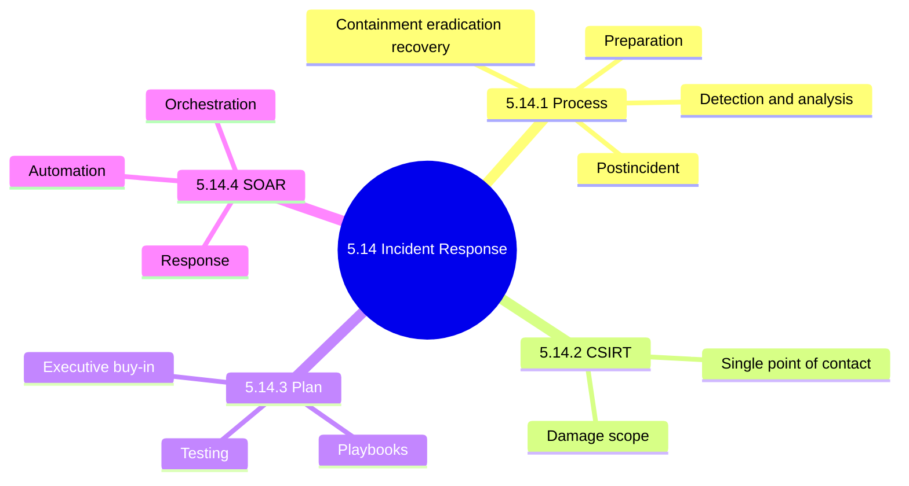
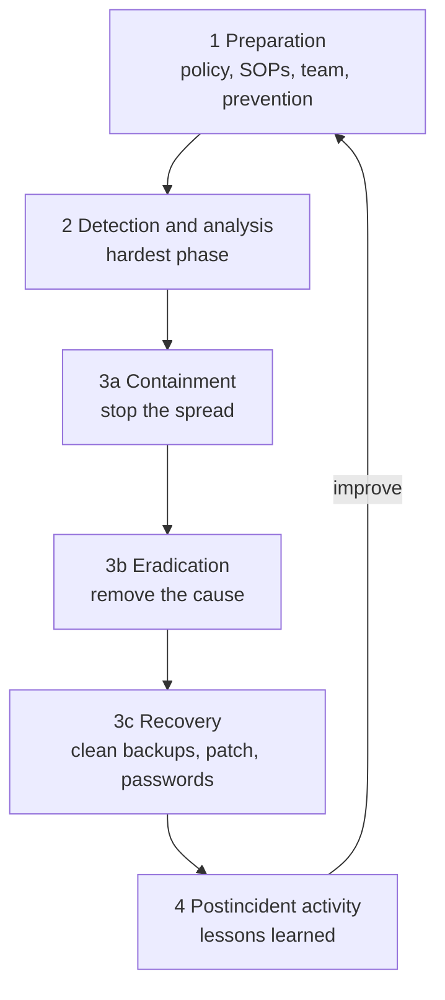
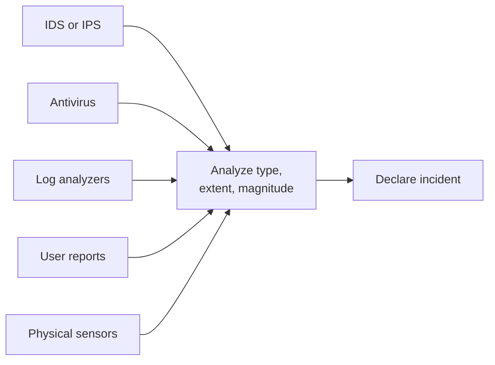
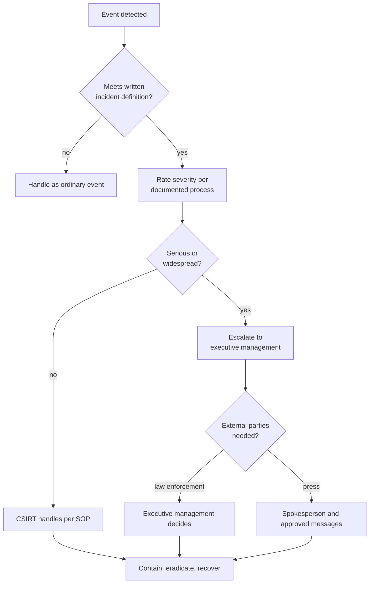
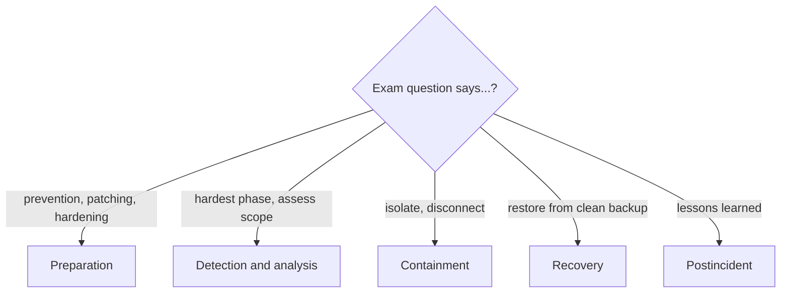
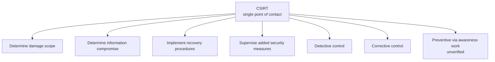
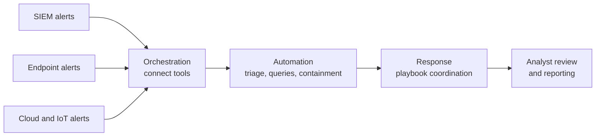

# 5.14 Security Incident Response Management: Diagrams

[← Domain 5](../README.md) | [Study notes](../Study-Notes/5.14-Study-Notes.md)

Markers: ⭐ frequently tested, 📓 in my notes, "(unverified)" marks ⚠ Check or ➕ items.

## Section map

### 5.14.1 Incident response process

Incident basics: not all incidents are computer-related; a burglary counts.

Severity and escalation decision tree. The notes give no severity levels, so this shows only the escalation logic the notes support; severity levels themselves are not defined (unverified).

<b>Preparation checklist</b>

- Define an incident in writing.
- Create incident response policy.
- Develop procedures: SOPs.
- Establish communication guidelines.
- Define incident response activities.
- Select incident response team.
- Establish notification mechanisms.
- Prevention: patching, hardening, perimeter configuration.

<b>Containment, eradication, recovery detail</b>

- Containment: shut down, disconnect, disable functions.
- Use a separate strategy per major incident type.
- Eradication: delete malicious code, disable breached accounts.
- Recovery: restore clean backups, rebuild, patch, change passwords.
- Recovery also tightens perimeter such as firewall rules.
- Manual allows eradication inside recovery (unverified, ⚠ Check).

<b>Postincident activity</b>

- Lessons-learned review judges handling effectiveness.
- Accumulated data reveals systemic weaknesses.
- Results feed training and awareness (outline marks ➕, manual states it).
- 📓 Incident resolution meantime is the best effectiveness indicator.

<b>Exam traps</b>

- Prevention belongs to preparation, not recovery.
- Policy sets roles; SOPs hold technical detail.
- Order is contain, eradicate, recover.
- Restoring a possibly infected backup reintroduces the incident.
- Number of incidents reported is a weak effectiveness measure.

### 5.14.2 Computer Security Incident Response Team (CSIRT)

<b>Common issues the plan must cover</b>

- Virus outbreak, malware, web defacement.
- Abuse notification, unauthorized access.
- IDS or IPS alerts, root compromise.
- Hardware or software theft.
- Physical security breach.
- Defamatory media, forensic investigations.

<b>Exam traps</b>

- CSIRT is centralized contact, not scattered.
- Auditor prefers a documented plan over informal expertise.
- Standby support and clear reporting lines must exist.

### 5.14.3 Incident response plan

| Best practice | Point |
|---|---|
| Automate repetitive tasks | Frees staff, cuts labor cost |
| Templates and playbooks | Assign roles, duties, deadlines |
| Centralize IR initiatives | One pool of tool data |
| Test the plan | Exercises calibrate for real incidents |
| Invest in IR training | Closes talent gaps |
| Standardize response | Faster learning for recruits |
| ⭐ Executive buy-in | Executives approve and supply resources |
| Confirm roles, backups | Auditor interviews staff |
| Document critical assets | Rank to set response speed |
| Crisis communications plan | Spokesperson, pre-approved messages |

<b>Exam traps</b>

- Untested plans are the common gap.
- Executive approval, not IT approval, is key.
- Treating all assets equally slows critical response.

<b>Example</b>

- A pre-approved breach statement avoids mid-incident sign-off delays.

### 5.14.4 Security Orchestration, Automation and Response (SOAR)

SOAR flow:

| Aspect | SIEM | SOAR |
|---|---|---|
| Core job | Collect, correlate, alert | Automate and coordinate response |
| Action | Alerts analysts only | Adds automation and response |
| Sources | Logs and events | Plus endpoint, cloud, IoT |
| Relationship | Feeds SOAR | Usually absorbs SIEM data |

<b>SOAR benefits</b>

- Visibility: dashboards across infrastructure.
- Lower security costs.
- Efficiency: less time per event.
- Effectiveness: accurate real-time interventions.
- Flexibility: fits existing setups.
- Collaboration on one platform.
- Streamlined operations with prebuilt workflows.

<b>Exam traps</b>

- Automated response needed: choose SOAR, not SIEM.
- SOAR extends SIEM; it does not replace log collection.
- Manual says automation eliminates error; reduces is safer (unverified).
- Manual claim SOAR can predict threats is unsupported (unverified).

### Quick recall

| Fact | Answer |
|---|---|
| ⭐ Four phases | Prep, detect and analyze, contain/eradicate/recover, post |
| ⭐ Hardest phase | Detection and accurate assessment |
| ⭐ Order | Contain, then eradicate, then recover |
| ⭐ CSIRT | Single point of contact |
| ⭐ Plan approval | Executive management |
| ⭐ Untested plan | Most common gap |
| 📓 Best effectiveness indicator | Incident resolution meantime |
| SOAR vs SIEM | SOAR adds automated response |
