# 5.15 Evidence Collection and Forensics: Diagrams

[← Domain 5](../README.md) | [Study notes](../Study-Notes/5.15-Study-Notes.md)

Markers: ⭐ frequently tested, 📓 in my notes, "(unverified)" marks ⚠ Check or ➕ items.

## Section map

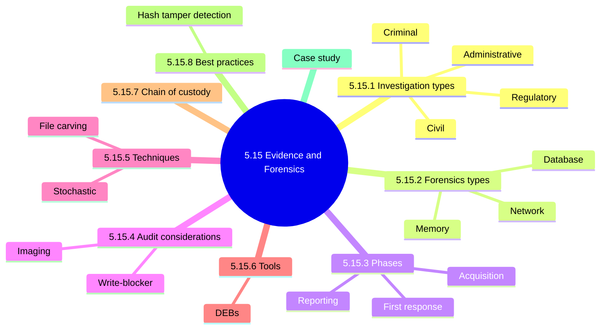

Core rule: leave the environment and evidence unaltered and call specialists. ⭐

### 5.15.1 Types of investigations

| Type | Goal | Proof standard |
|---|---|---|
| Administrative | Facts for objective action, HR cases | Not stated |
| ⭐ Criminal | Convict perpetrator with law enforcement | Beyond reasonable doubt |
| ⭐ Civil | Monetary damages | Preponderance of evidence |
| Regulatory | Regulator checks rules, such as SEC | Comply and supply evidence |
| Industry standards | Check adherence to a standard | Not stated |
| Forensic | Documented chain of evidence for court | Court-presentable |

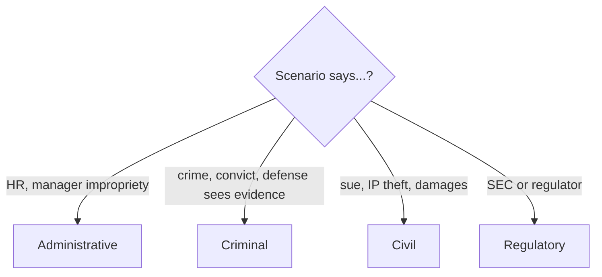

<b>Exam traps</b>

- Criminal is beyond reasonable doubt; civil is preponderance.
- Civil outcome is money; criminal is conviction.
- First action: preserve and call specialists, not clean up.
- Fixing the vulnerability first alters the evidence.

### 5.15.2 Types of computer forensics

| Type | Examines |
|---|---|
| Database | Database data and metadata |
| Email | Messages, contacts, schedules |
| Mobile | Messages, photos, videos, contacts |
| Memory | Data in process, via live analysis |
| Network | Recorded traffic and events |
| Malware | Code and payloads of viruses, ransomware, Trojans |

<b>Exam traps</b>

- Memory forensics pairs with live analysis.
- RAM data vanishes at shutdown.

### 5.15.3 Phases of computer forensics

Forensic process flowchart (the manual's nine phases, grouped into the five core steps).

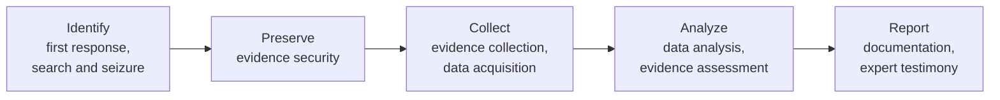

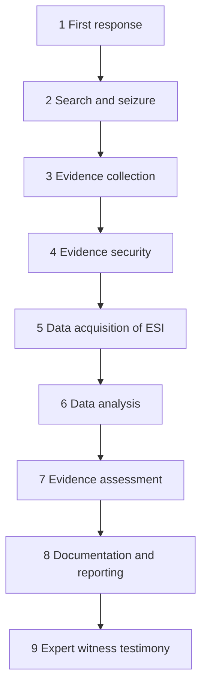

<b>Exam traps</b>

- Order matters: secure and acquire before analysis.
- Auditor verifies phases are followed for every forensics type. ⭐
- Wrong acquisition procedure alters data and harms integrity.

### 5.15.4 Audit considerations

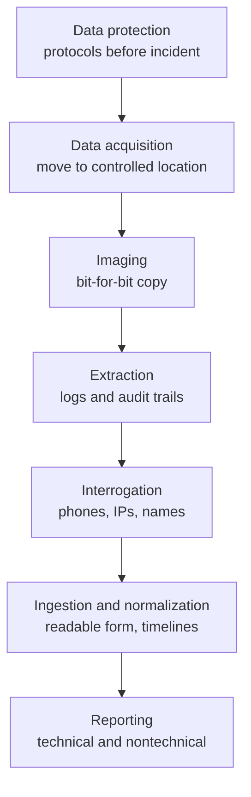

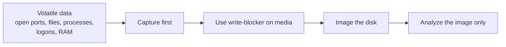

Order of volatility. The notes list the volatile items but give no ranking among them; only that volatile data is captured before shutdown and persistent disk is imaged. Any finer ranking is unverified.

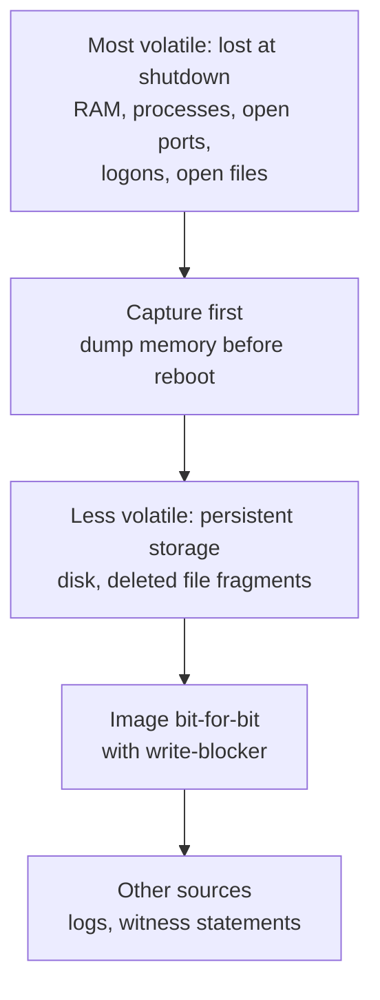

| Reporting | Audience |
|---|---|
| ⭐ Technical report | IT staff |
| ⭐ Nontechnical report | Management |

<b>Exam traps</b>

- A file copy is not an image; only bit-for-bit captures deleted fragments.
- One technical report for everyone is wrong.
- Report needs conclusions and reservations, not only raw findings.
- Powering off destroys volatile data.

<b>Report goals</b>

- Accurate, understandable, defensible, unambiguous.
- States why reviewed, how reviewed, conclusions.
- Notes circulation restrictions and auditor reservations.

<b>Unverified manual points (⚠ Check)</b>

- Write-blocker is a device in 5.15.4 but software in 5.15.8 (unverified).

### 5.15.5 Computer forensic techniques

| Technique | Use |
|---|---|
| Deleted file recovery | Also file or data carving |
| Reverse steganography | Hash comparison finds hidden data |
| Cross-drive analysis | Correlate drives; anomaly detection |
| Live analysis | Volatile RAM and cache; lab extraction preferred |
| Stochastic forensics | Insider cases without artifacts |

<b>Exam traps</b>

- Insider case with no artifacts: stochastic forensics.
- Hash comparison: reverse steganography.
- Deleted file recovery equals file carving.

### 5.15.6 Computer forensics tools

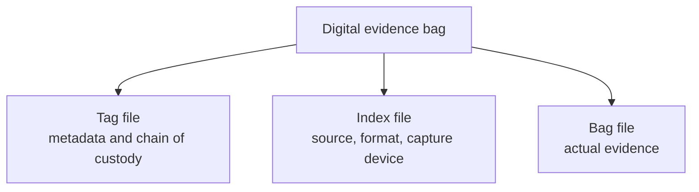

| Tool class | Purpose |
|---|---|
| Acquisition | Mirror-image, bit-stream backups |
| Analysis | File listing; suspects use TrueCrypt, Hide and Seek |
| File recovery | Restore deleted files; EnCase opens suspicious files |

<b>Exam traps and unverified items</b>

- Evidence tools must be trusted and proven.
- Manual names SafeBank as acquisition example (unverified).
- Manual calls a DEB a plastic bag (unverified).

### 5.15.7 Chain of custody

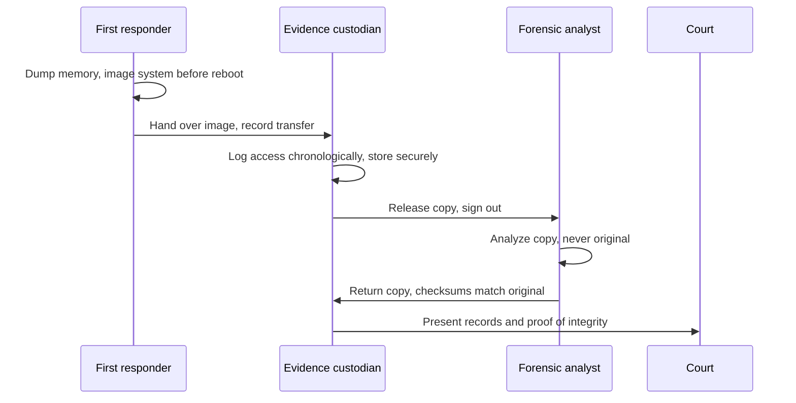

| Chain of custody records | Detail |
|---|---|
| ⭐📓 Who had access | In chronological order |
| Procedures followed | Disk duplication, memory dump |
| Proof copies match original | Checksums, timestamps |

<b>Exam traps</b>

- Image first, then analyze the copy.
- Booting a suspect PC writes to the drive.
- Checksums prove copies match; passwords do not.
- Gaps in records can make evidence inadmissible.

### 5.15.8 Best practices to secure digital evidence

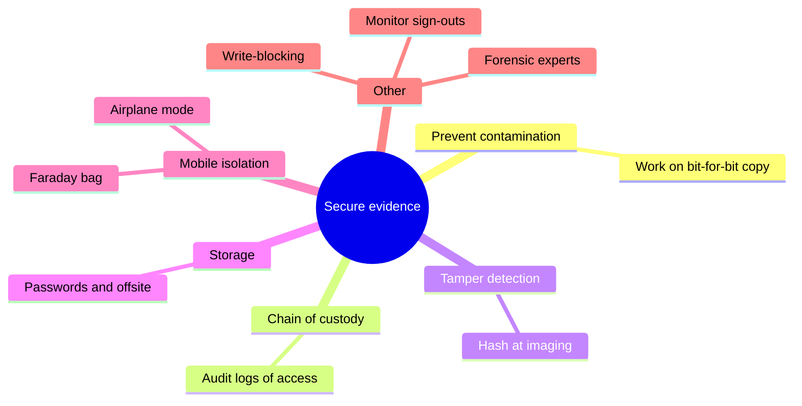

<b>Unverified manual points (⚠ Check, ➕)</b>

- Manual says power phone off, yet also leave power state unchanged (unverified).
- Full disk encryption is not always the best option (unverified).
- Antistatic paper packaging listed for mobile devices (unverified).
- Write-blocking described as software here, device earlier (unverified).

<b>Exam traps</b>

- Hash mismatch signals tampering.
- Leave devices in their current power state.
- Evidence extends beyond hardware: email headers, chat, websites.

### Case study (ORM) stem summary

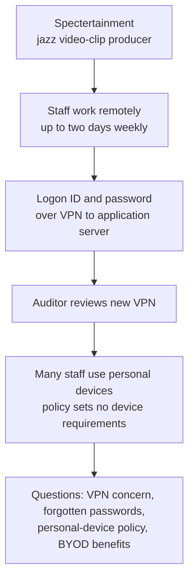

| Question topic | Answer from outline |
|---|---|
| VPN concern | Remote PCs at home; VPN does not protect them from Internet attack |
| Impact | Compromised remote PC enables lateral movement |
| Greatest protection | Access control software at network and OS level |
| Forgotten password | Verify identity by challenge/response first |
| Personal devices policy | Acceptable use policy and BYOD policy |
| BYOD benefits | Productivity and cost savings |
| BYOD drawback | Harder to terminate access |

<b>Stem details</b>

- Staff use laptops and tablets; remote work raised morale.
- Staff trained; written security procedures exist.
- Security administrator assigns initial passwords; first logon forces change.
- Remote access policy exists without personal-device requirements.

### Quick recall

| Fact | Answer |
|---|---|
| ⭐ First action | Leave evidence unaltered; call specialists |
| ⭐ Criminal vs civil | Beyond reasonable doubt vs preponderance |
| ⭐ Phases | Followed regardless of forensics type |
| ⭐ Reports | Two: technical and nontechnical |
| ⭐📓 Chain of custody | Who, procedures, proof copies match |
| ⭐ Analysis target | Image copy, never original |
| Insider, no artifacts | Stochastic forensics |
| Integrity proof | Hash values and checksums |
