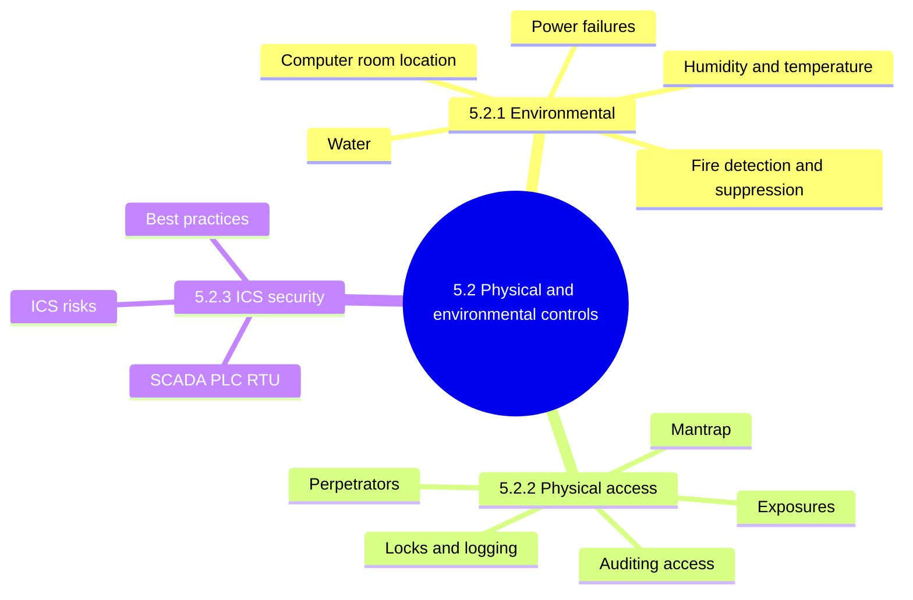
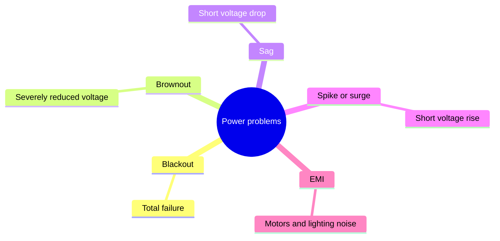
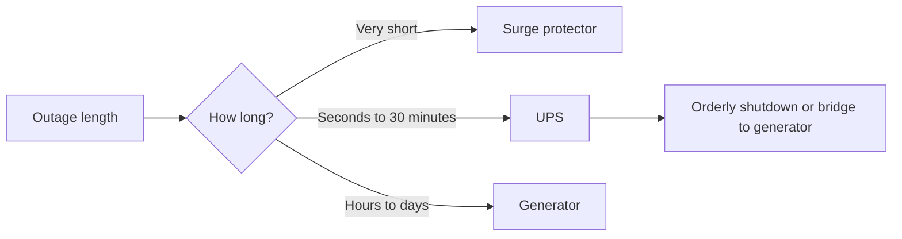
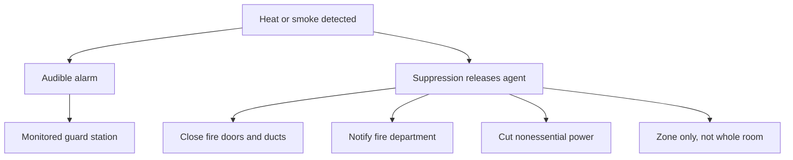
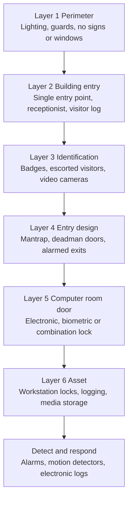
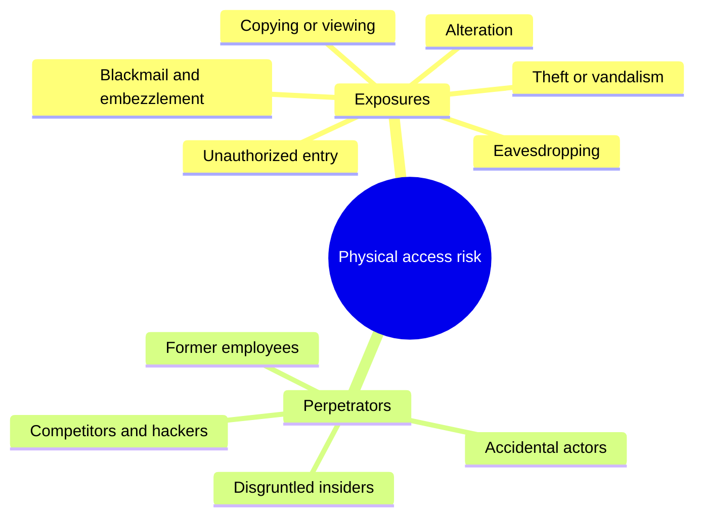
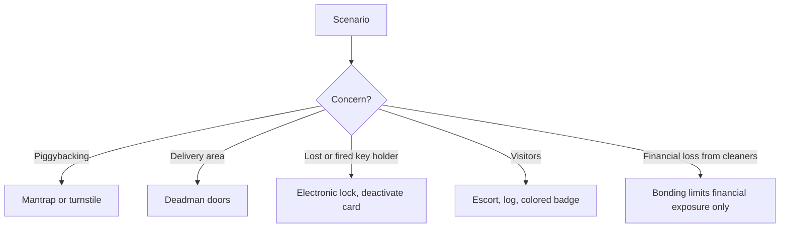
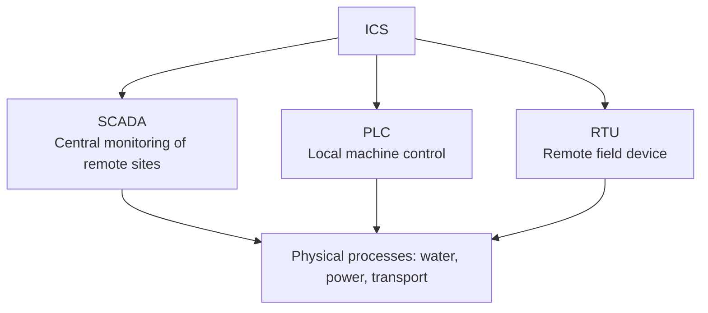

# 5.2 Physical and Environmental Controls - Diagrams

[← Domain 5](../README.md) | [Study notes](../Study-Notes/5.2-Study-Notes.md)

> Markers: 📓 = in my notes, ⭐ = frequently tested, ➕ / ⚠ Check = unverified.

## Section map

### 5.2.1 Environmental exposures and controls

Environmental controls by hazard:

| Hazard | Exposure | Control |
|---|---|---|
| Power: short interruption | Millionths to thousandths of a second | Surge protectors |
| Power: intermediate | Seconds to 30 minutes | UPS |
| Power: long-term | Hours to days | Generator: diesel, gasoline, propane |
| Power: line failure | Utility lines damaged | Power leads from two substations |
| Power: spikes, sags | Data loss, hardware damage | Surge protectors, voltage regulators |
| Fire: warning | Early detection | Smoke detectors, manual alarms, extinguishers |
| Fire: suppression | Automatic extinguishing | Dry-pipe sprinkler, FM-200, Novec 1230 |
| Fire: building | Spread of fire | Two-hour fire-rated walls, floor to ceiling |
| Water | Leaks, flooding, even upper floors | Water detectors, avoid basement and top floor |
| HVAC | Heat, humidity, static, dust | Adequate air conditioning, humidity and temperature control |
| Emergency | Electrical hazard, danger to staff | Two emergency power-off switches |

Power failure categories:

Match outage length to control:

Fire response chain:

Suppression types:

| Type | How it works | Note |
|---|---|---|
| Total flooding | Agent fills enclosed 3D space | Needs enclosure |
| Local application | Agent applied directly onto fire | No enclosing barriers |
| Wet sprinkler | Water always in pipes | Leak risk |
| Dry-pipe sprinkler | Water flows after alarm activates pump | Lower leak risk |
| FM-200 | Gas agent | Often preferred |
| Novec 1230 | Clean agent | FM-200 alternative |

<b>Auditor questions on the environment</b>

- Is power within manufacturer specifications?
- Are air conditioning, humidity and ventilation adequate?
- Is equipment protected from static and dust?
- Are food, drink and tobacco prohibited?
- Are backup media protected from heat, magnetism and water?
- Is maintenance scheduled and followed?

<b>Exam traps</b>

- Smoke detectors supplement, never replace, suppression.
- Dry-pipe beats wet-pipe where leaks would damage equipment.
- Auditor reviews test records; does not discharge the system.
- Evacuation: human safety first, then controlled shutdown.
- Two substations answer external power-line exposure.
- UPS alone cannot cover a two-day outage.
- Fire-rated walls: minimum two hours.
- ⚠ Check: 108-125 volts brownout range is US-specific.
- Cloud and outsourced datacenters still need environmental review.

<b>Example</b>

- A nearby motor causes random server crashes; shielding fixes it.
- Computer room in a basement: plastic sheet diverts water.

### 5.2.2 Physical access exposures and controls

Physical security layers (defense in depth):

Perpetrators and exposures:

Lock comparison:

| Lock | Key point |
|---|---|
| Bolting | Metal key stamped do not duplicate |
| Combination | Change on transfer or termination |
| Electronic | Per-person card, by door or hour, easy to deactivate |
| Biometric | Body trait, see section 5.7.16 |

Entry control choice (exam logic):

Audit tour of physical access:

<b>Facilities to protect</b>

- Computer rooms, tape libraries, storage rooms.
- Offsite backup storage and communications closets.
- Operator consoles, printers, LANs.
- Power sources and disposal sites.

<b>Exam traps</b>

- Most likely source: accidental person. Greatest impact: malicious.
- Hidden cameras detect; visible cameras and signs deter. 📓
- Mantrap answers piggybacking; badges alone do not.
- Bonding limits financial exposure, not physical risk.
- Labeled computer room is a finding.
- Human safety outranks security.
- External guards should be bonded.

<b>Example</b>

- Intruder crawls over a partition that stops at the false ceiling.
- Cigarette stubs at emergency doors suggest misuse.

### 5.2.3 Industrial Control Systems (ICS) security

ICS risk and matching best practice:

| Risk | Best practice |
|---|---|
| No asset visibility | Asset inventory and classification |
| Flat network, no zones | Segment with ICS-protocol-aware firewalls |
| Unauthenticated commands | Least privilege, secure remote access with encryption |
| Weak configuration and patching | Harden, block unused ports, patch |
| Unmonitored third parties | Supply chain security, vendor assessment |
| Undetected threats | IDS/IPS, monitor network baselines |
| Weak physical access | Guards and badges |
| Outages | Redundancy, incident response plan |

<b>More ICS risks</b>

- Improper input validation and authentication.
- Internet-connected embedded controllers.
- Aging devices cannot run strong cryptography.
- Weak proprietary protocols leave content unprotected.
- ICT dependencies can destabilize ICS.
- Third parties on site may modify the environment.
- Compliance risk: breaches, penalties, fines.

<b>Exam traps</b>

- ICS risk is unauthenticated commands and flat networks, not only theft.
- Segmentation, not air gaps, is the current recommendation.
- Office standards such as ISO 27001 may not fit ICS.

### Quick recall

| Fact | Detail |
|---|---|
| ⭐ Outage matching | Surge protector, UPS, generator |
| ⭐ Smoke detectors | Warn only; suppression extinguishes |
| ⭐ Dry-pipe sprinkler | Lower leak risk than wet pipe |
| ⭐ Mantrap | Stops piggybacking |
| ⭐ Human safety | Always first |
| Bonding | Financial protection only |
| Fire wall rating | Two hours minimum |
| Computer room location | Middle floors, no signs |
| Emergency power-off | Two switches, shielded |
| ICS fix | Segmentation, least privilege, inventory |
