# 5.3 Identity and Access Management (IAM) - Diagrams

[← Domain 5](../README.md) | [Study notes](../Study-Notes/5.3-Study-Notes.md)

Markers: 📓 = in my notes, ⭐ = frequently tested, ➕ / ⚠ Check = unverified.

## Section map

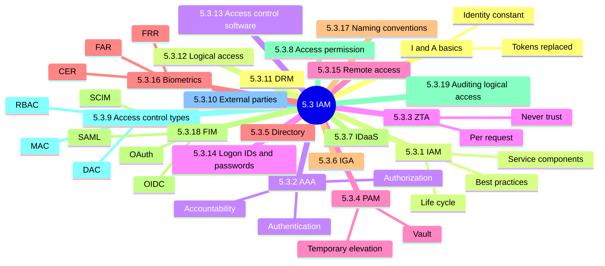

### 5.3.0 Basics: Identification and Authentication (I&A)

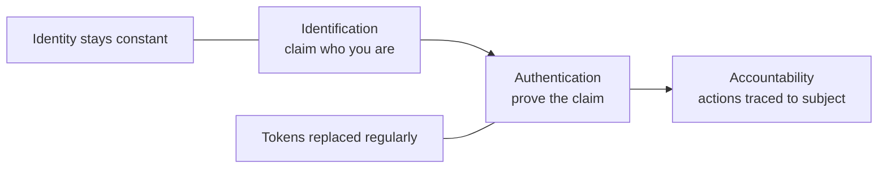

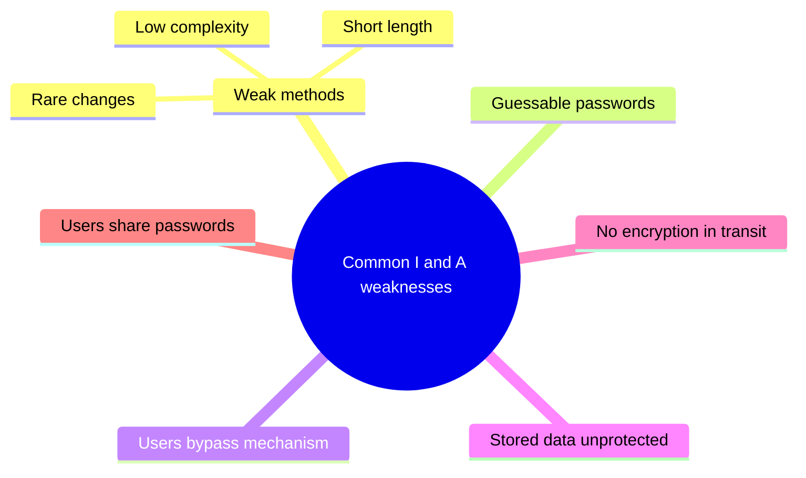

<details>
<summary><b>Exam traps</b></summary>

- Weak passwords are fixed by policy and education, not more logging.
- Encrypting storage alone is incomplete; transit must be encrypted too.
- Example: employee ID never changes, password rotates.

</details>

### 5.3.1 IAM

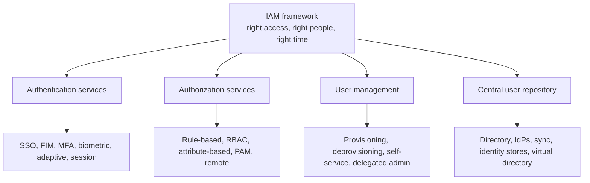

IAM life cycle (provisioning flow):

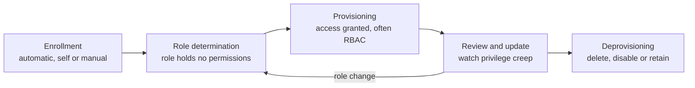

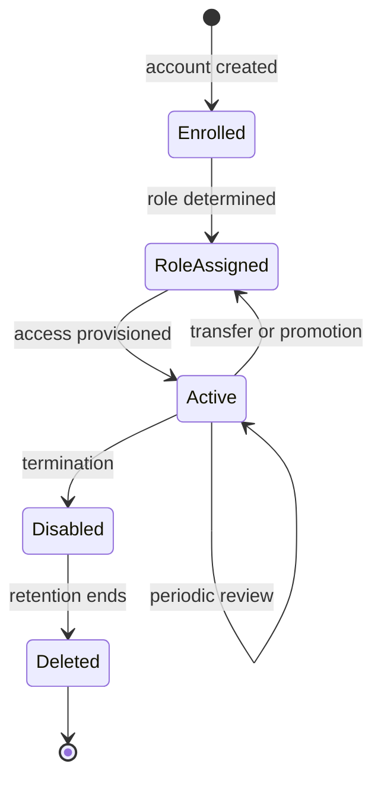

| Area | Good-practice value (manual) |
|---|---|
| Password change | 30 days privileged, 90 days regular |
| Failed attempts | Suspend after five |
| Screensaver time-out | 15 minutes |
| Password history | Last 13 here (⚠ Check: 12 in 5.3.14) |
| Account revalidation | Six months regular, three months privileged |
| Unvalidated accounts | Lock within one working day, five at most |
| Policy review | Yearly |

<details>
<summary><b>Benefits of IAM</b></summary>

- Improves regulatory compliance with trackable activity.
- Adds authentication layers and limits lateral movement.
- Promotes digital transformation.
- Improves productivity through SSO.
- Streamlines access control, notably in cloud.

</details>

<details>
<summary><b>Best practices (Figure 5.7)</b></summary>

- Authorized approver for access, transfer, creation requests.
- Privileged and shared access need two-level approval.
- Apply POLP; limit servers holding shared accounts.
- Publish list of users sharing an account.
- Change shared passwords on departure or role change.
- Revoke user IDs as soon as termination requested.
- Send passwords by encrypted email or sealed envelope.
- Check SoD on every IAM request; automate it.
- Remove dormant and orphan accounts; name an owner for each.

</details>

<details>
<summary><b>Exam traps</b></summary>

- Shared privileged account with several admins is the most serious finding.
- History depth and review cadence rank below lost accountability.
- Quoted numbers are manual good-practice values, not universal laws.
- A role does not itself contain permissions.
- Do not confuse role determination with provisioning.

</details>

### 5.3.2 Authentication, authorization and accountability

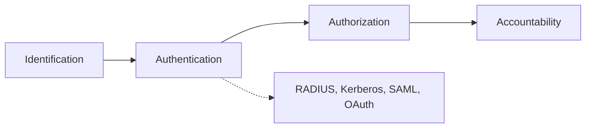

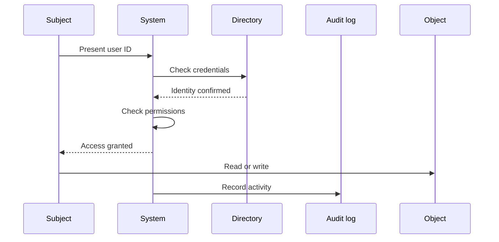

MFA factors mind map:

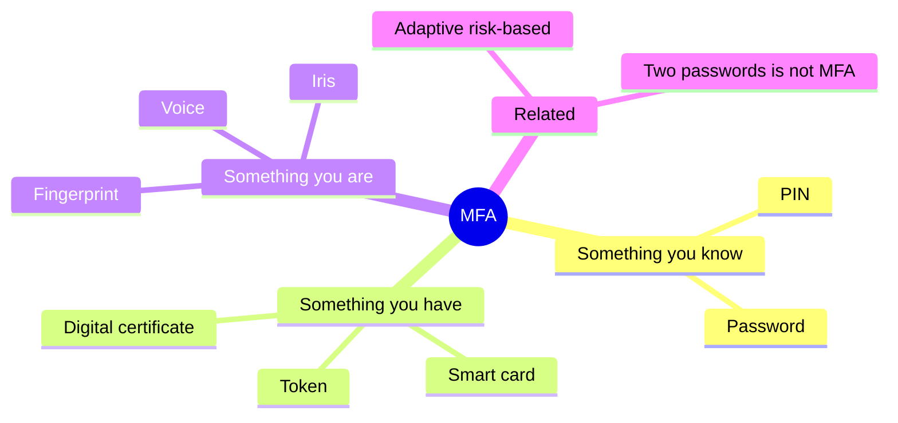

Authentication methods:

| Method | Key point |
|---|---|
| Password | Something you know; weakest alone |
| MFA | Different factor types combined |
| Adaptive | Extra factors on risky context |
| Token-based | Something you have; common in RESTful APIs |
| Certificate-based | Digital certificates prove identity |
| LDAP | Bind request with identifier and password |
| Smart card | Embedded microprocessor; revoke if lost |
| Biometric | Physical or behavioral trait, see 5.3.16 |

SSO flow:

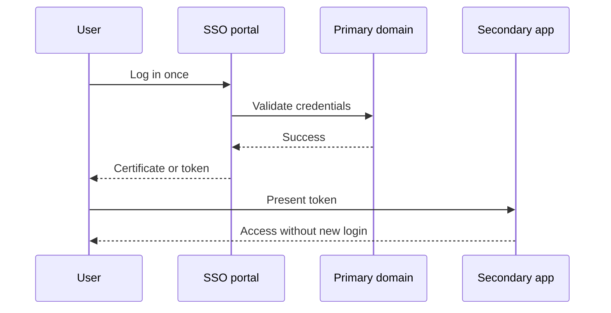

Authorization:

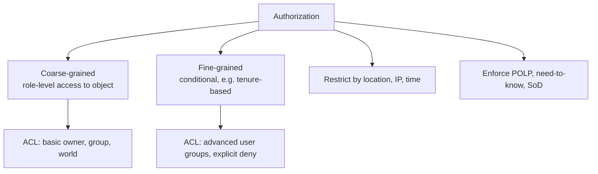

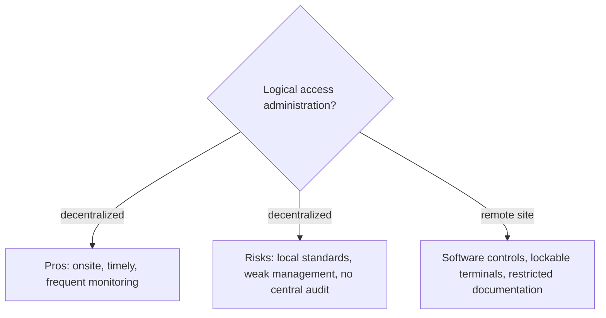

<details>
<summary><b>SSO pros and cons</b></summary>

- Pros: stronger passwords, easier administration, fewer resets, faster logins.
- Cons: hard to support all OS; integration cost.
- Key risk: single point of failure and total compromise.
- Mitigation: strong authentication and biometrics.

</details>

<details>
<summary><b>File access types and accountability checks</b></summary>

- Read/inquiry/copy; write/create/update/delete; execute.
- Read-only is the least dangerous access type.
- Logs form the audit trail: nonrepudiation, deterrence, fault isolation.
- Auditor checks: no shared passwords, default admin accounts removed.
- Service IDs must not be interactive.
- Match proximity cards and video to event logs.

</details>

<details>
<summary><b>Exam traps</b></summary>

- Shared privileged accounts violate individual accountability and non-repudiation 📓⭐.
- Compensating logging does not restore accountability on shared accounts.
- Two passwords are not MFA; factors must differ.
- Adaptive reacts to risk; MFA always applies factors.
- Authorization follows authentication.
- Stale rights after transfers are the classic ACL finding.

</details>

### 5.3.3 Zero-Trust Architecture (ZTA)

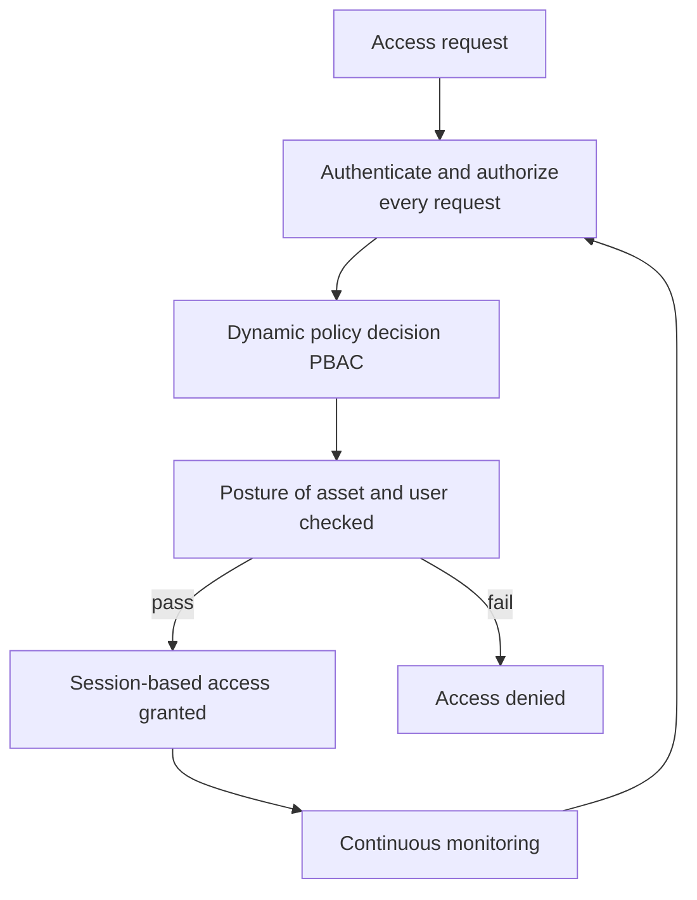

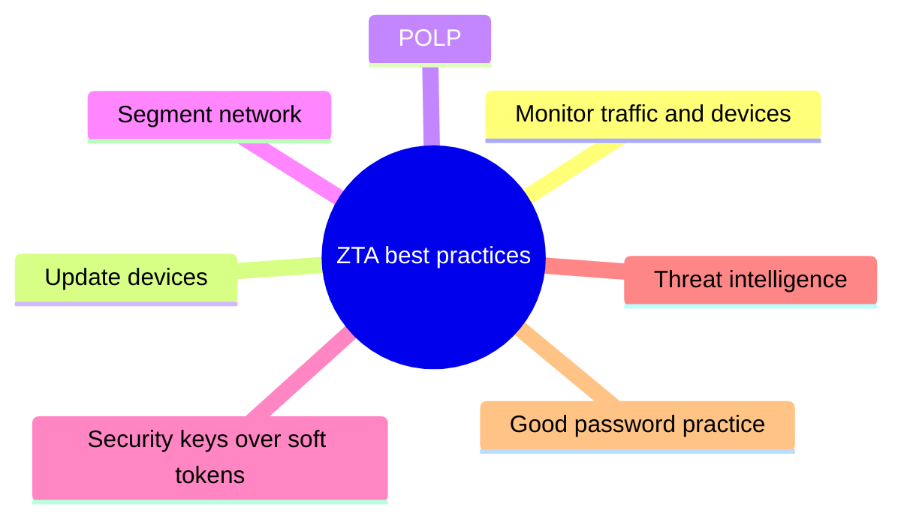

<details>
<summary><b>NIST SP 800-207 basics</b></summary>

- All data and computing services are resources.
- Communication secured regardless of network location.
- Session-based access per request.
- Dynamic policy-based access control.
- Monitor and measure asset posture.
- Dynamic authentication and authorization.
- Intensive information gathering.

</details>

<details>
<summary><b>Exam traps</b></summary>

- Internal network location never grants implicit trust.
- A perimeter firewall alone is not zero trust.
- IAM under ZTA: central identities, MFA plus adaptive, attribute-based policy.

</details>

### 5.3.4 Privileged Access Management (PAM)

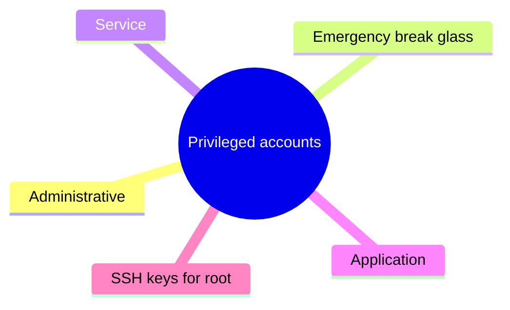

PAM checkout flow:

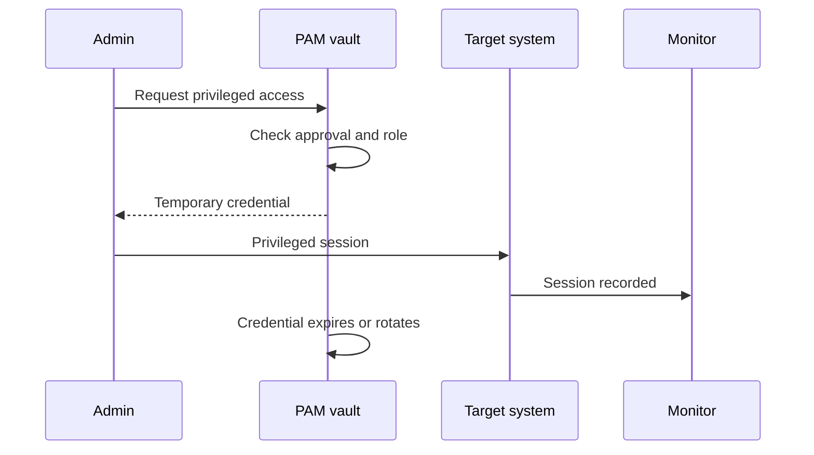

PAM lifecycle:

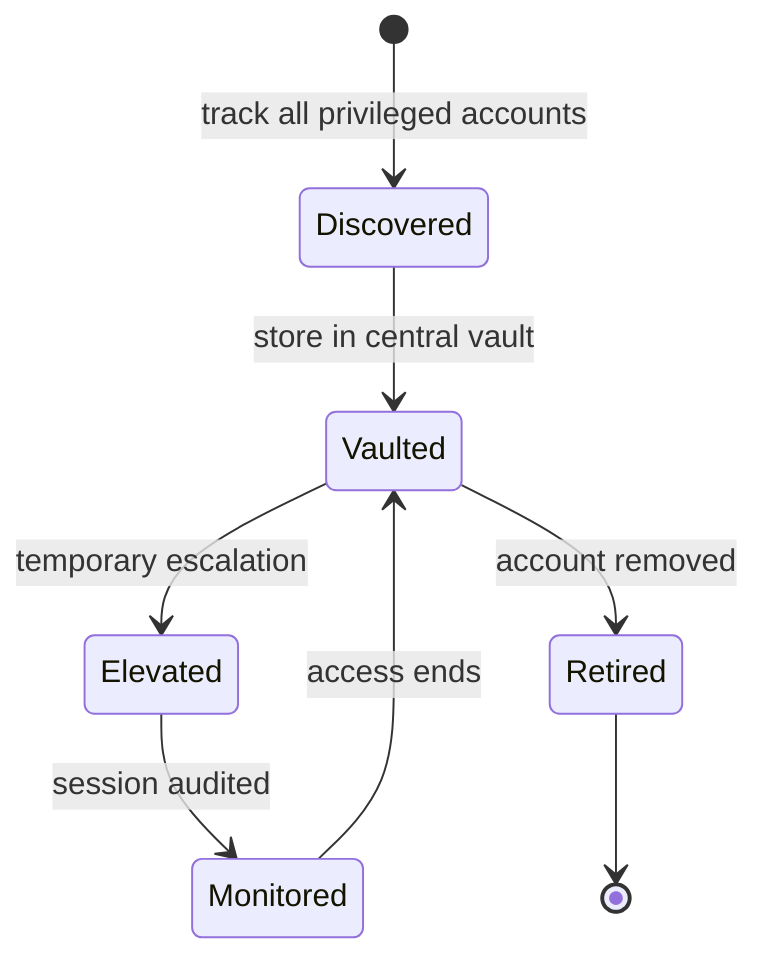

<details>
<summary><b>Benefits and risks</b></summary>

- Benefits: smaller attack surface, least privilege, no privilege creep.
- Resolves shared and static password risks.
- Risk: manual credential management is error-prone.
- Risk: hard to track privileged activity.
- Risk: cloud privileged access and Kerberos weaknesses.

</details>

<details>
<summary><b>Best practices</b></summary>

- Implement POLP first; implement RBAC; automate PAM.
- Use temporary privilege escalation.
- Vault infrastructure and third-party credentials.
- No hardcoded credentials.
- Remove local admin groups to limit lateral movement.
- Run periodic red team exercises.

</details>

<details>
<summary><b>Exam traps</b></summary>

- Standing permanent admin rights are weaker than temporary elevation.
- Hardcoded credentials in code are a finding.

</details>

### 5.3.5 Directory services

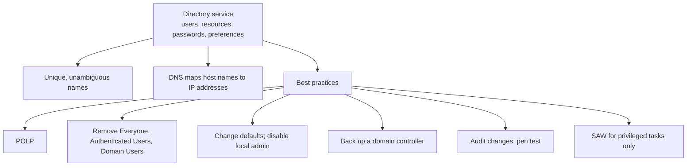

<details>
<summary><b>Exam traps</b></summary>

- Broad groups such as Everyone on sensitive objects are a finding.
- A SAW is dedicated; browsing and email on it defeats the purpose.
- Directory compromise affects the whole enterprise.

</details>

### 5.3.6 Identity Governance and Administration (IGA)

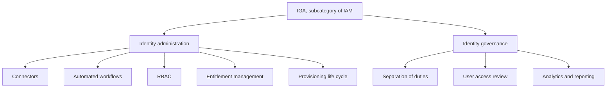

<details>
<summary><b>Challenges addressed</b></summary>

- Efficient identity management and increased visibility.
- Streamlined governance; improved accountability.
- Better security posture; reduced risk.
- Promoted compliance; productivity; scalability.

</details>

<details>
<summary><b>Exam traps</b></summary>

- Administration creates access; governance reviews and challenges it.

</details>

### 5.3.7 Identity as a Service (IDaaS)

| Benefits | Risks |
|---|---|
| Reduced costs | Dependence on Internet connectivity |
| Improved security | Limited customization |
| Scalability | Third-party provider security concerns |
| Flexibility | Regulatory compliance |
| Simpler identity management | Integration challenges |

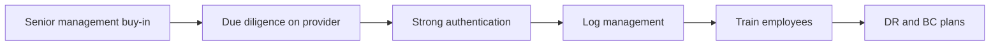

<details>
<summary><b>Definition and traps</b></summary>

- Cloud-delivered IAM on subscription basis.
- Should support SSO, MFA, provisioning, cloud directory.
- Outsourcing the service does not outsource accountability.

</details>

### 5.3.8 System access permission

```mermaid
flowchart TD
    A["Information owner<br/>written authorization"] --> B["Security administrator<br/>implements access rules"]
    B --> C["Access rule<br/>user, resource, level, conditions"]
    C --> D["Periodic review vs authorization matrix"]
    D -->|"mismatch"| E["Remove excess access"]
    D --> F["Tie to HR transfers and terminations"]
```

```mermaid
mindmap
  root((Four logical layers))
    Networks
    Platforms
    Databases
    Applications
```

<details>
<summary><b>Details and traps</b></summary>

- Permission: read, create, modify, delete, execute.
- Guided by need-to-know, least privilege, accountability, traceability.
- Nonemployees are accountable: contractors, vendors, auditors, visitors.
- Owners authorize; administrators only implement.
- Reviews prevent authorization creep.

</details>

### 5.3.9 Types of access controls

Access control models comparison:

| Model | Who decides | Key point |
|---|---|---|
| MAC | System policy | Labels vs clearance; users cannot change; prohibitive |
| DAC | Data owner | Owner decides access; cannot override MAC |
| RuBAC | Predefined rules | Usually an ACL |
| RBAC | Job role | Industry-standard good practice |
| ABAC | Attributes | User, object, environmental attributes |
| PBAC | Policy | Policy decides role privileges |

DAC, MAC, RBAC as the core trio is flagged ➕ (unverified, not in review manual).

```mermaid
quadrantChart
    title Control model by central control and flexibility
    x-axis "Low central control" --> "High central control"
    y-axis "Rigid" --> "Flexible"
    quadrant-1 "Central and flexible"
    quadrant-2 "Local and flexible"
    quadrant-3 "Local and rigid"
    quadrant-4 "Central and rigid"
    DAC: [0.15, 0.85]
    RBAC: [0.65, 0.6]
    MAC: [0.92, 0.12]
```

The quadrant placement is illustrative only (unverified; not stated in the notes).

```mermaid
flowchart TD
    Q{"Exam question says"}
    Q -->|"owner decides sharing"| A["DAC"]
    Q -->|"labels and clearance"| B["MAC"]
    Q -->|"access by job role"| C["RBAC"]
    Q -->|"user, object, environment attributes"| D["ABAC"]
    Q -->|"predefined rules or ACL"| E["RuBAC"]
```

<details>
<summary><b>Exam traps</b></summary>

- DAC never overrides MAC.
- MAC is prohibitive: not expressly permitted means forbidden.
- Role does not hold permissions; policy or assignment does.
- Example: military labels (MAC) vs user sharing a folder (DAC).

</details>

### 5.3.10 Information security and external parties

```mermaid
flowchart LR
    A["Risk assessment"] --> B["Controls in place"]
    B --> C["Contract and NDA signed"]
    C --> D["Access granted"]
    D --> E["Monitor and audit"]
    E --> F["Return or destroy information at end"]
```

```mermaid
mindmap
  root((External party security))
    Identify risk
      Right to audit
      Access type and location
      Information sensitivity
      Legal requirements
    Customers
      Service description
      Incident reporting
      Service levels
      Right to monitor and revoke
    Third-party agreements
      Indemnification
      Subcontractors
      Termination conditions
      ISO 27001 or SOC 2
```

<details>
<summary><b>Exam traps</b></summary>

- Contract and controls come before access, never after.
- Right-to-audit beats relying on vendor self-assertion.
- Imposed agreements must not weaken your own security.

</details>

### 5.3.11 Digital Rights Management (DRM)

```mermaid
flowchart LR
    D["DLP detects leakage"] --> R["DRM denies misuse"]
    R --> X1["Copy, edit, share, print limits"]
    R --> X2["Location limit"]
    R --> X3["Expiration"]
```

| DRM technology | Note |
|---|---|
| Password protection | Technical |
| Digital watermarking | Steganography |
| Device control | Technical |
| Restrictive licensing | Legal, not technical |
| Blockchain trust infrastructure | Digital trust |
| Hashing, TLS | Integrity, secure transport |
| Timebound decryption keys | Access expires |

<details>
<summary><b>Best practices and traps</b></summary>

- Content inventory; risk-based approach; automate DRM.
- Integrate with DLP; minimize shadow IT; employee buy-in.
- Use free DRM tools first (➕ unverified).
- Licensing alone does not technically stop copying.

</details>

### 5.3.12 Logical access

```mermaid
flowchart TD
    U["User or remote party"] --> FE["Front-end systems<br/>face untrusted networks"]
    FE --> ID["Intermediate devices<br/>security doors"]
    ID --> BE["Back-end systems<br/>hold databases"]
    DC["Primary domain controller"] --> BE
    LAN["LAN access"] --> DC
    VPN["Remote access via VPN"] --> DC
```

<details>
<summary><b>Exposures and entry points</b></summary>

- Data leakage: original remains, so loss may go undetected.
- Computer shutdown needs a high-level logon ID.
- Others: unauthorized software, data modification, data destruction, spying.
- Entry points: domain controllers, application servers, databases.
- Routers and firewalls strictly controlled.
- Unknown entry points are a bigger concern than weak known ones.

</details>

### 5.3.13 Access control software

```mermaid
flowchart TD
    L1["Network and platform or OS<br/>greatest protection"] --> L2["Database"]
    L2 --> L3["Application"]
    L1 --> F1["Profiles, I&A, logon limits, usage notice, logging"]
    L3 --> F2["Authorization at application, transaction, field level"]
    L2 --> F3["Log access violations"]
```

<details>
<summary><b>Exam traps</b></summary>

- Upper layers rely on lower infrastructure layers.
- Strong application controls fail if the OS beneath is weak.

</details>

### 5.3.14 Logon IDs and passwords

```mermaid
flowchart TD
    A["Password attack"] --> S["Sniffing"]
    A --> P["Phishing"]
    A --> B["Brute force"]
    A --> D["Dictionary"]
    A --> K["Keylogger"]
    A --> R["Rainbow table"]
    A --> C["Credential stuffing"]
    A --> Y["Password spraying"]
    S --> S1["Defense: encrypt transmission"]
    B --> B1["Defense: lockout"]
    D --> B1
    K --> K1["Defense: prevention"]
    R --> R1["Defense: salting"]
    C --> C1["Defense: user education"]
    Y --> Y1["Few passwords per account, avoids lockout"]
```

<details>
<summary><b>Password features</b></summary>

- Individual logon ID, standardized format; initial password random.
- Forced change at first login; users change their own.
- Lockout after failed attempts; reset only after identity check.
- Hash passwords with a strong algorithm; mask on screen.
- History: no reuse of last 12 (⚠ Check vs 13 in 5.3.1).
- Admin password in sealed envelope: firecall ID.

</details>

<details>
<summary><b>Exam traps</b></summary>

- Salting defeats rainbow tables; lockout does not.
- Spraying avoids lockout and targets SSO and cloud.
- Hashing is one-way; hash stored passwords.
- Rename or disable defaults: Guest, Administrator, Admin.

</details>

### 5.3.15 Remote access security

```mermaid
flowchart LR
    subgraph R["Risks"]
        R1["DoS"]
        R2["Malicious third parties"]
        R3["Misconfigured software or devices"]
        R4["Unsecured hosts"]
        R5["Weak physical security"]
    end
    subgraph C["Controls"]
        C1["Policy and standards"]
        C2["Authorization"]
        C3["Strong I and A"]
        C4["Encryption VPN, TLS"]
        C5["IDS, IPS, DLP monitoring"]
    end
    R --> C
```

<details>
<summary><b>Details and traps</b></summary>

- Remote users: employees, vendors, consultants, partners, customers.
- Strong I&A plus encryption beats network location as a control.

</details>

### 5.3.16 Biometrics

Enrollment and matching:

```mermaid
flowchart LR
    A["Acquire sample"] --> B["Extract unique code"]
    B --> C["Initial template"]
    C --> D["Compare new samples"]
    D --> E["Final template stored"]
    E --> F["One-to-one verification"]
    E --> G["One-to-many identification"]
```

Biometrics error rates:

| Metric | Meaning | Note |
|---|---|---|
| FER | People who cannot enroll | Causes: physical differences, training, environment |
| FRR | Authorized user rejected | Type 1 error; inconvenience |
| FAR | Impostor accepted | Type 2 error; worst for security |
| CER or EER | Point where FRR equals FAR | Lower means more accurate |

```mermaid
flowchart TD
    S["Sensitivity setting"] -->|"raise"| H["FRR up, FAR down"]
    S -->|"lower"| L["FRR down, FAR up"]
    H --> C["Tune toward CER"]
    L --> C
```

Manual's FRR and FAR formulas are flagged as inverted (⚠ Check, unverified); the formulas are not restated here.

Types:

```mermaid
mindmap
  root((Biometric types))
    Physical
      Palm
      Hand geometry
      Iris
      Retina
      Fingerprint
      Face
    Behavioral
      Signature dynamics
      Voice
```

| Type | Strength or weakness |
|---|---|
| Palm | Ridges and valleys |
| Hand geometry | Oldest; 10 to 20 byte template; low uniqueness |
| Iris | 400+ traits, about 260 used; no contact; costly |
| Fingerprint | Low cost; needs contact; stores minutiae |
| Face | Lacks uniqueness; lookalikes fool it |
| Voice | Recorded passphrase, noise, voice changes |
| Signature | Speed, pen pressure, direction, stroke length |

<details>
<summary><b>Management and audit considerations</b></summary>

- Life cycle: enrollment, transmission, storage, verification, identification, termination.
- Approve a biometric policy (BIMS); cover in BCP.
- Provide backup authentication if the device fails.
- Audit: privacy, health, expertise, robustness, cost and ROI.
- Audit: accuracy (FAR), security, compliance.
- Best response and lowest CER order: palm, hand, iris, retina, fingerprint, voice.

</details>

<details>
<summary><b>Exam traps</b></summary>

- FAR is security-critical; FRR is mainly an inconvenience.
- Lowest CER is best overall accuracy, not lowest FRR alone.
- Failed device needs backup authentication, not disabled controls.
- Feature changes such as scars reduce effectiveness.

</details>

### 5.3.17 Naming conventions for logical access controls

```mermaid
flowchart LR
    A["Data owners and security officer"] --> B["Set naming rules"]
    B --> C["Common high-level qualifier"]
    C --> D["Generic rules cover many resources"]
    D --> E["Fewer rules, simpler administration"]
    B --> F["Supports accountability and SoD"]
```

### 5.3.18 Federated Identity Management (FIM)

SAML-style federation sequence:

```mermaid
sequenceDiagram
    participant U as User
    participant SP as Service provider
    participant IdP as Identity provider
    U->>SP: Request service
    SP->>IdP: Ask for authentication
    U->>IdP: Log in
    IdP-->>U: Access token
    U->>SP: Present token
    SP-->>U: Service access
```

OAuth authorization sequence:

```mermaid
sequenceDiagram
    participant U as User
    participant A as Application
    participant AS as Authorization server
    participant R as Resource
    U->>A: Request access to resource
    A->>AS: Ask for authorization
    U->>AS: Approve access
    AS-->>A: Authorization token
    A->>R: Use token, no password shared
    R-->>A: Data
```

| Technology | Role |
|---|---|
| SAML | XML format for authentication and authorization exchange |
| OAuth | Authorization tokens without sharing credentials |
| OIDC | Identity layer on OAuth 2.0, uses JSON |
| SCIM | Automates identity exchange for provisioning |

| FIM | SSO |
|---|---|
| Spans multiple domains | Within one organization |
| Decentralized | Centralized |
| Common on consumer sites | Common in business |
| Less secure: credentials work across entities | Single point of compromise |

<details>
<summary><b>Benefits and limitations</b></summary>

- Benefits: fewer logins, better experience, single-point provisioning.
- Benefits: secure sharing, easier management, lower cost.
- Limits: IdP dependency, reduced control, reduced flexibility, higher cost.
- Requires mutual trust, usually by contract, and a secure channel.

</details>

<details>
<summary><b>Exam traps</b></summary>

- OAuth authorizes; SAML and OIDC carry identity assertions.
- Cross-organization trust means FIM, not plain SSO.

</details>

### 5.3.19 Auditing logical access

```mermaid
flowchart TD
    A["1 Familiarize with IT environment<br/>interviews, walk-throughs, documents, risk assessments"] --> B["2 Assess and document access paths<br/>terminal to data"]
    B --> C["3 Interview systems personnel"]
    C --> D["4 Review access control software reports"]
    D --> E["5 Review application operations manual"]
    C -->|"weak answers"| F["Expand testing"]
```

<details>
<summary><b>Details and traps</b></summary>

- Check origination, authorization, validity of input data.
- Check OS patching, hardening, closed ports.
- Firewalls do not stop HTTP-borne application attacks.
- Review unsuccessful attempts by time, terminal, logon, file.
- Sample end users on policy awareness.
- Understand the environment before testing controls.

</details>

### Quick recall

| Fact | Detail |
|---|---|
| ⭐ Shared privileged accounts | Violate accountability and non-repudiation |
| ⭐ Chain | Identification, authentication, authorization, accountability |
| ⭐ FAR | Impostor accepted, Type 2, worst for security |
| ⭐ CER | FRR equals FAR; lower is more accurate |
| ⭐ MFA | Factors must differ in type |
| Zero trust | Never trust, always verify, per request |
| PAM | Vault, temporary elevation, no hardcoded credentials |
| FIM vs SSO | FIM crosses organizations; SSO within one |
| OAuth vs SAML | OAuth authorizes; SAML and OIDC assert identity |
| External parties | Contract and controls before access |
