# 5.4 Network and Endpoint Security: Diagrams

[← Domain 5](../README.md) · [Study notes](../Study-Notes/5.4-Study-Notes.md)

> Markers: 📓 in my notes, ⭐ frequently tested, ➕ unverified. Items tagged "(unverified)" carry a ⚠ Check in the notes.
> NAC and zero trust are not covered in the 5.4 outline or study notes, so they are not drawn here. Closest content: micro-segmentation and EDR/XDR.

## Section map

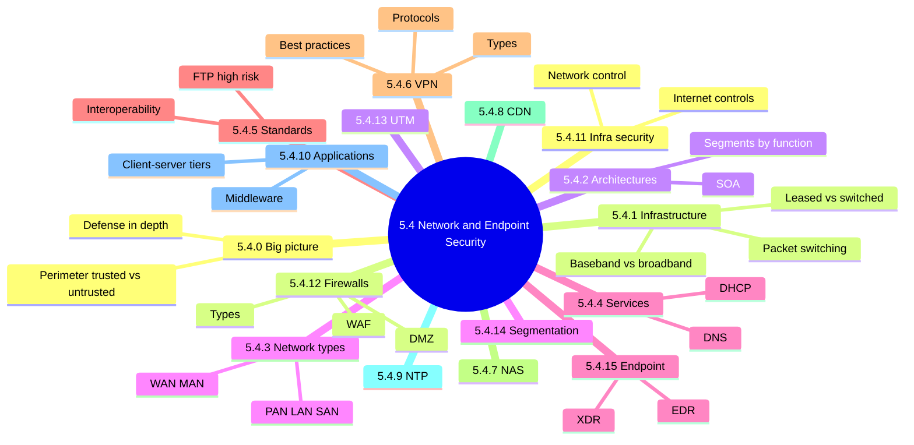

### 5.4.0 Big picture

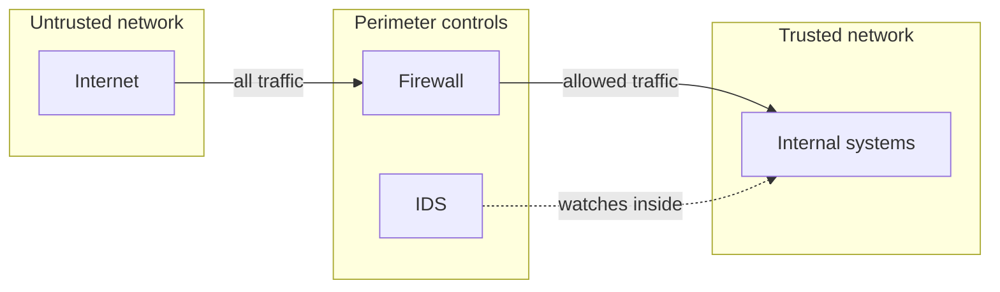

<details>
<summary><b>Definitions</b></summary>

- Perimeter security: controls at the trusted/untrusted border.
- Trusted network: internal, organization controls it.
- Untrusted network: outside organizational control, such as the Internet.
- Defense in depth: several layers so one failure exposes little.

</details>

### 5.4.1 IS network infrastructure

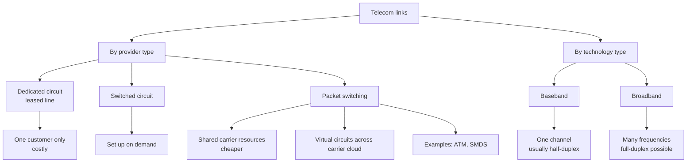

| Feature | Baseband | Broadband |
|---|---|---|
| Signal | Direct on link | Multiple carrier frequencies |
| Channels | One | Many |
| Duplex | Usually half | Full possible |

<details>
<summary><b>Exam traps</b></summary>

- Leased line means dedicated and costly; packet switching means shared and cheaper.
- Baseband carries a single channel; broadband multiplexes many.
- Full-duplex baseband modems exist; half-duplex is only typical (unverified).

</details>

### 5.4.2 Enterprise network architectures

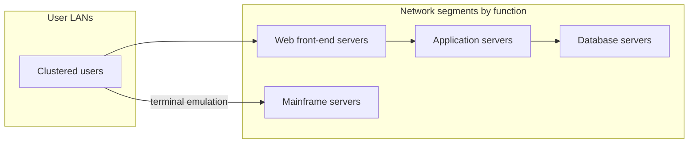

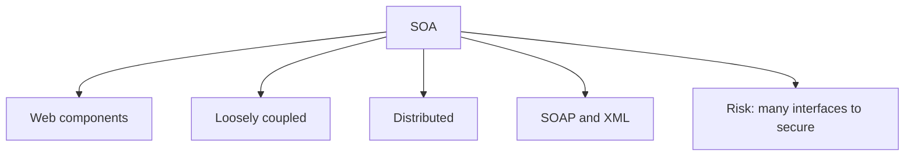

<details>
<summary><b>Exam traps</b></summary>

- Segmenting by function is a design choice, not a security control alone.
- SOA components are loosely coupled, not tightly integrated.
- Auditor needs working knowledge of LAN and WAN specifications.

</details>

### 5.4.3 Types of networks

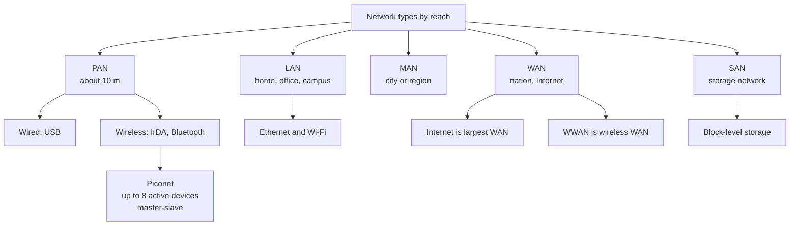

| Aspect | SAN | NAS |
|---|---|---|
| Access level | Block | File |
| Structure | Network of storage devices | Single RAID-based device |
| Risks | Weak authentication, lateral movement | See 5.4.7 |

<details>
<summary><b>SAN risks and controls</b></summary>

- Risks: physical threats, protocol and configuration flaws.
- Risks: strict authentication often not enforced.
- Risks: attackers move laterally with stolen credentials.
- Controls: strong, frequent authentication.
- Controls: track who may access each application or database.
- Controls: each department protects its own sensitive data.

</details>

<details>
<summary><b>Exam traps</b></summary>

- Block-level means SAN; file-level means NAS.
- Piconet is Bluetooth, master-slave, up to eight active devices.
- Internet is the largest WAN, not a MAN.

</details>

### 5.4.4 Network services

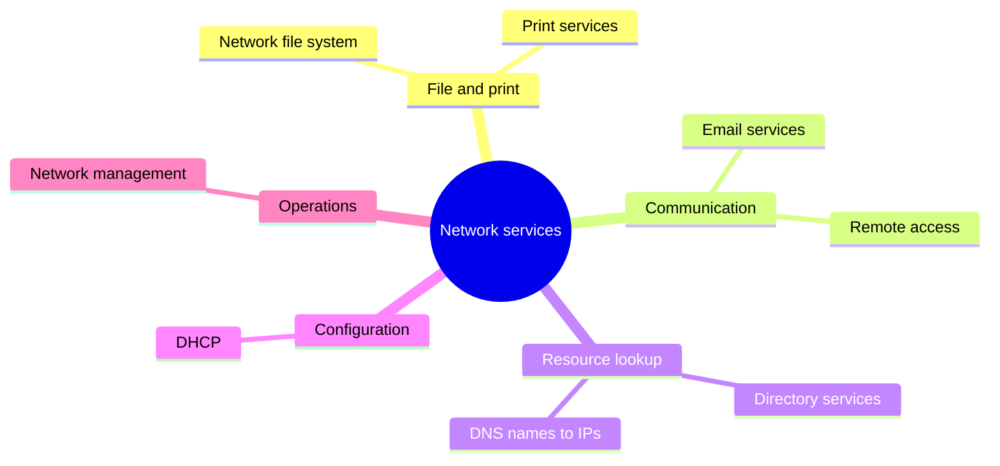

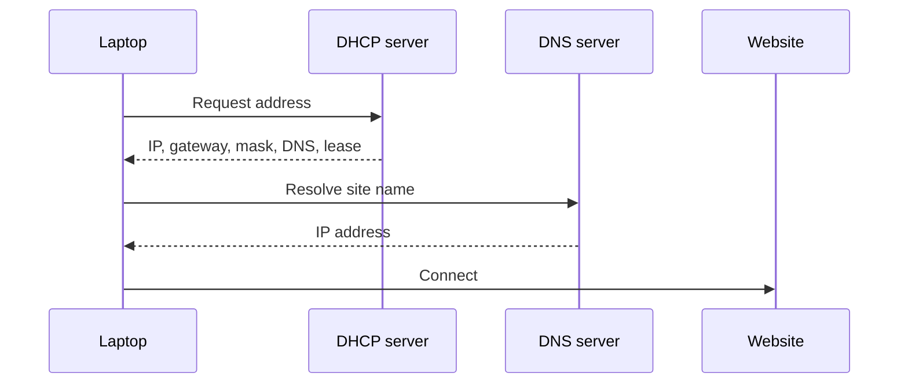

<details>
<summary><b>Network management reports</b></summary>

- Line status and active terminals.
- Message queue length and error rate.
- Traffic levels, giving early warning of problems.

</details>

<details>
<summary><b>Exam traps</b></summary>

- DHCP assigns addresses; DNS translates names.
- The server, not an administrator, manages the DHCP pool.
- Tampered DNS redirects users; protect and monitor it.

</details>

### 5.4.5 Network standards and protocols

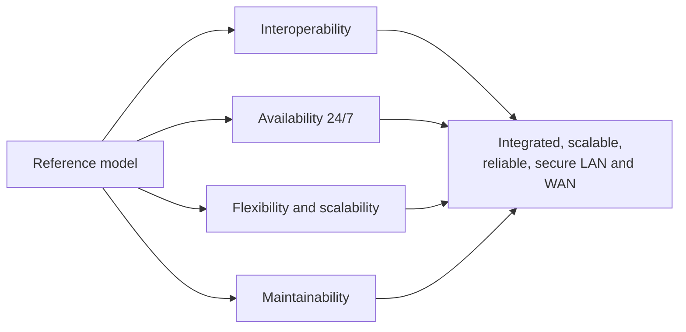

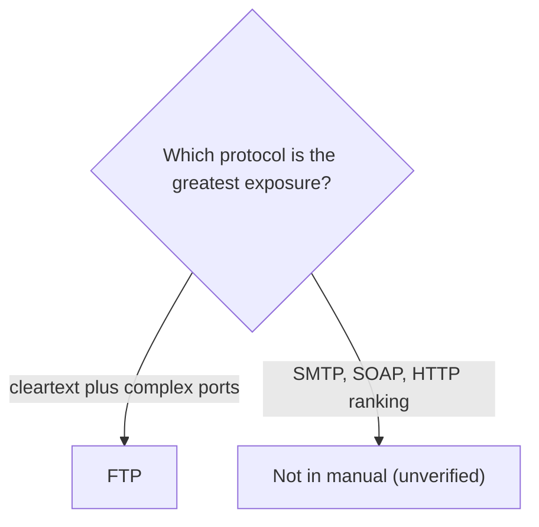

<details>
<summary><b>Exam traps</b></summary>

- Cleartext credentials plus multiple ports points to FTP.
- Notes flag both FTP and HTTP; resolve before exam (unverified).
- The SMTP, SOAP, HTTP risk comparison is not in the manual (unverified).

</details>

### 5.4.6 Virtual Private Networks (VPN) 📓

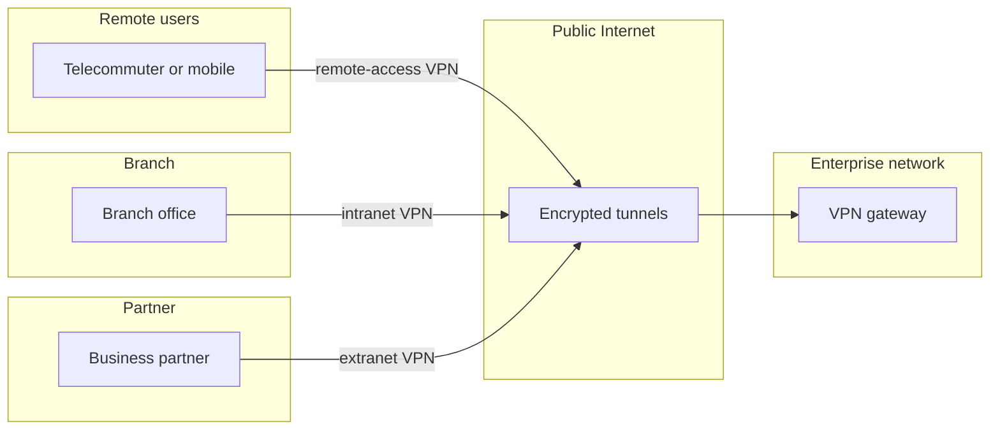

| VPN type | Connects | Note |
|---|---|---|
| Remote-access | Telecommuters, mobile users | To enterprise WAN |
| Intranet | Branch offices | Same enterprise |
| Extranet | Business partners | Each manages own VPN |

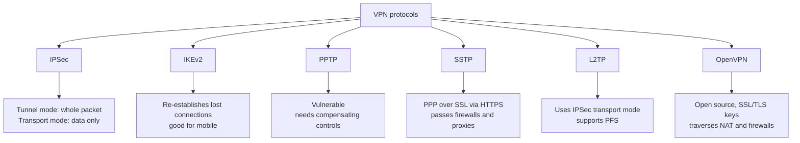

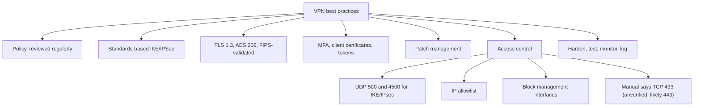

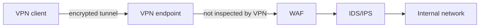

<details>
<summary><b>Primary VPN issues</b></summary>

- Transmission security: hijacking and malware entry.
- Managing the technology.
- Configuration management.
- Keeping information unaltered and reliable.

</details>

<details>
<summary><b>Exam traps</b></summary>

- Public Wi-Fi interception: answer is VPN or encryption in transit. 📓
- VPN protects confidentiality in transit, not endpoint malware.
- VPN encrypts but does not inspect or filter tunnel traffic.
- Tunnel mode hides headers; transport mode protects payload only.
- Intranet versus extranet differ in who manages the VPN.
- TCP port 433 wording is a likely typo for 443 (unverified).

</details>

### 5.4.7 Network Attached Storage (NAS)

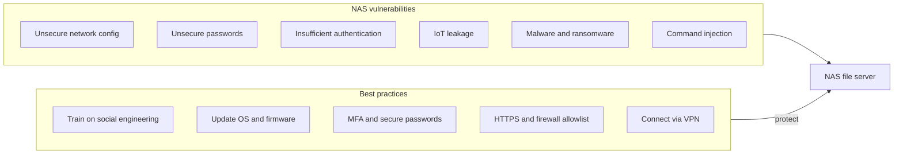

<details>
<summary><b>Exam traps</b></summary>

- Exposed remote NAS access: VPN plus MFA, not passwords alone.
- NAS is file-level; do not confuse with SAN block storage.
- Example: ransomware spreads from unpatched IoT camera to an open NAS.

</details>

### 5.4.8 Content Delivery Networks (CDN)

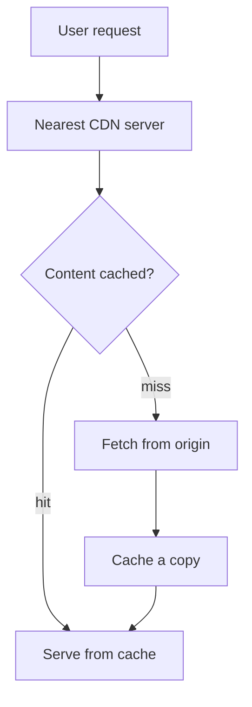

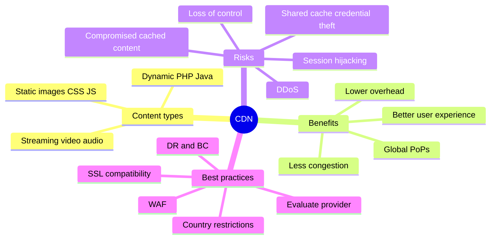

<details>
<summary><b>Exam traps</b></summary>

- CDN improves availability and helps against DDoS 📓, but is not a firewall.
- Shared cache means one breach reaches many tenants.

</details>

### 5.4.9 Network Time Protocol (NTP)

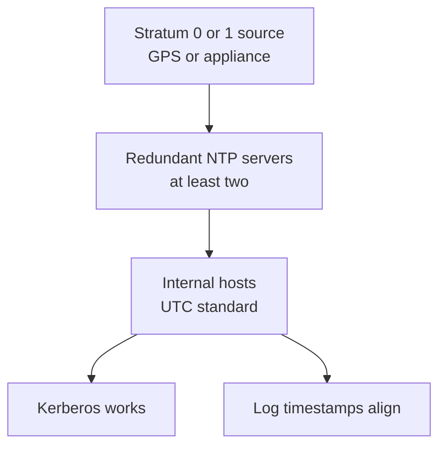

| Benefits | Risks |
|---|---|
| Consistent time improves security | Weak options: MD5, SHA-1, Autokey |
| Traceable source aids compliance | Spoofing, fake UDP fragments |
| Redundant servers raise reliability | Kiss-of-death attacks |
| Eases network management | Time set back enables replay |

<details>
<summary><b>Best practices</b></summary>

- Public NTP for external hosts.
- Hierarchy with Stratum 0 or 1 appliances.
- Standardize on UTC.
- Evaluate need for cryptography.
- Use at least two servers.
- Limit strata levels.
- Monitor servers, GPS signal loss and SNMP.

</details>

<details>
<summary><b>Exam traps</b></summary>

- Unprotected NTP lets attackers change log sequence.
- Forensics needs logs from different systems to align.
- Best fix is redundant, hierarchical, monitored servers.

</details>

### 5.4.10 Applications in a networked environment

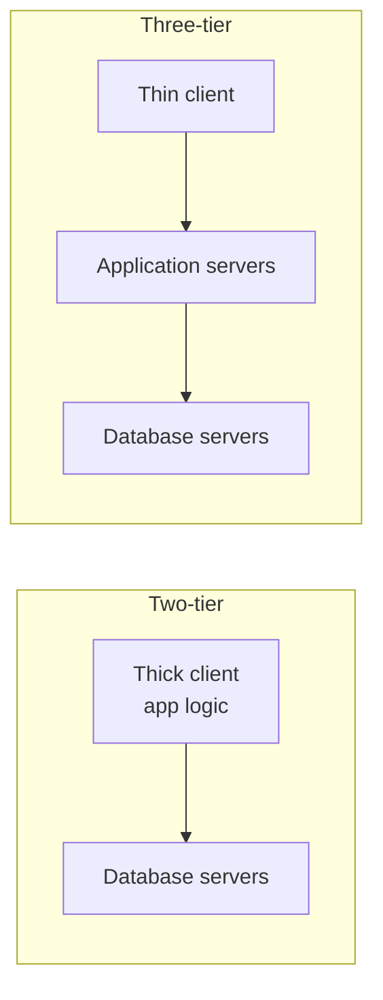

| Aspect | Two-tier | Three-tier |
|---|---|---|
| Client | Thick | Thin |
| Scalability | Limited | Better, load balanced |
| Drawback | Client sync, DB account bypass | N-tier harder to build |

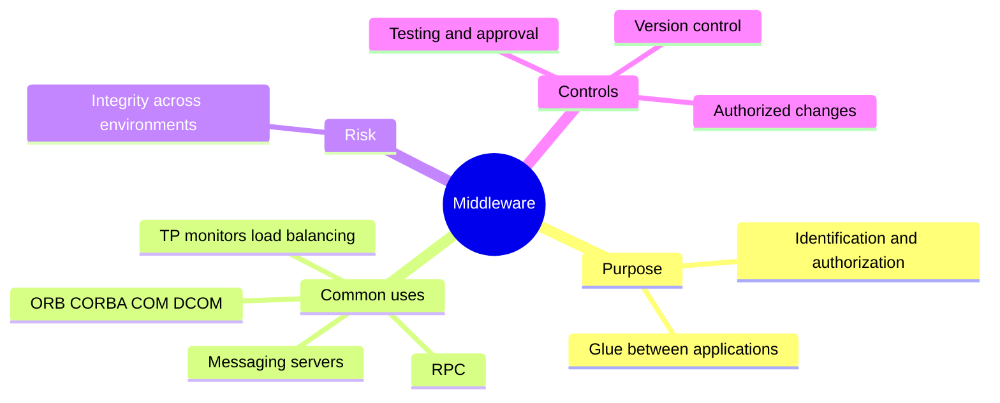

```mermaid
flowchart TD
    OD["On-demand computing"] --> B["Benefit: no payment for excess capacity"]
    OD --> C["Concern: confidentiality at third-party provider"]
```

<details>
<summary><b>Auditor checks (client-server)</b></summary>

- Application controls cannot be bypassed.
- Passwords are always encrypted.
- Minimal, audited access to configuration files.
- Two-tier gap: database accounts bypass application controls.
- Two-tier gap: proxy account password stored insecurely.

</details>

<details>
<summary><b>Exam traps</b></summary>

- Direct database accounts in two-tier designs: classic bypass.
- Three-tier fixes scalability and logic separation, not every risk.
- Utility computing concern is provider confidentiality, not cost.

</details>

### 5.4.11 Network infrastructure security

```mermaid
flowchart TD
    NI["Network infrastructure security"] --> NC["Communication network controls"]
    NI --> IC["Internet security controls"]
    NC --> N1["Trained staff"]
    NC --> N2["Separate and rotate duties"]
    NC --> N3["Operators cannot edit own logs"]
    NC --> N4["Audit trail reviewed periodically"]
    NC --> N5["Device hardening and inventory"]
    NC --> N6["Consolidated logs"]
    IC --> I1["Policy first"]
    IC --> I2["Classify resources"]
    IC --> I3["OS hardening"]
    IC --> I4["Firewall and IDS standards"]
    IC --> I5["Incident handling"]
    IC --> I6["Monitor, CERT bulletins"]
```

<details>
<summary><b>More controls</b></summary>

- Document operation standards; monitor system engineer access.
- Terminal identification file authenticates terminals.
- Encrypt messages in transit; restrict remote printing.
- ITIL practices for network operation SLAs.
- Periodic risk assessments of web applications.
- Remote access control and configuration management.

</details>

<details>
<summary><b>Exam traps</b></summary>

- Policy and classification come first; technical controls follow.
- Operators must not alter their own activity logs.
- Separation and rotation of duties applies to network control.

</details>

### 5.4.12 Firewalls 📓

```mermaid
flowchart TD
    FWT["Firewall types"] --> PF["Packet filtering"]
    FWT --> ST["Stateless"]
    FWT --> SF["Stateful inspection"]
    FWT --> NG["Next Generation"]
    FWT --> AF["Application firewall systems"]
    FWT --> WA["Web Application Firewall"]
    AF --> ALG["Application-level gateway"]
    AF --> CLG["Circuit-level gateway"]
    PF --> PF1["Screening router, ACLs<br/>first generation"]
    SF --> SF1["Tracks connection state"]
    NG --> NG1["DPI, IDS/IPS, app awareness"]
    WA --> WA1["Layer 7 web traffic"]
```

| Type | Inspects | Strength | Weakness |
|---|---|---|---|
| Packet filtering | Headers, IPs, ports | Simple, stable | Spoofing, fragments, router compromise |
| Stateless | Static header info | Basic restriction | No connection context |
| Stateful | Connection state | Blocks outside-initiated attacks | Complex to administer |
| NGFW | Application and packet contents | DPI, IPS, threat intel | Must validate claims |
| App-level gateway | One proxy per service | Hides internal network | Poor performance, scalability |
| Circuit-level gateway | General TCP/UDP proxy | Validates sessions | Rare |
| WAF | HTTP to web apps | Stops XSS, injection | Web only |

```mermaid
flowchart TD
    PFA["Packet filtering attacks"] --> A1["IP spoofing"]
    PFA --> A2["Source routing"]
    PFA --> A3["Miniature fragment"]
    A1 --> M1["Drop internal-looking external packets"]
    A2 --> M2["Drop source-routed packets"]
    A3 --> M3["Drop fragmented packets"]
```

```mermaid
flowchart LR
    subgraph NGF["NGFW features"]
        N1["Application awareness"]
        N2["Deep packet inspection"]
        N3["Integrated IDS/IPS"]
        N4["Threat intelligence"]
        N5["Antimalware"]
    end
    NGF --> FW["FWaaS: cloud-based option"]
```

```mermaid
flowchart TD
    W["WAF"] --> WM["Security model"]
    W --> WD["Deployment"]
    WM --> BL["Blocklist: negative"]
    WM --> AL["Allowlist: positive"]
    WM --> HY["Most are hybrid"]
    WD --> NB["Network-based<br/>low latency, costly"]
    WD --> HB["Host-based<br/>scalable, costly upkeep"]
    WD --> CB["Cloud-based<br/>minimal effort, less visibility"]
```

#### Firewall implementations and placement

```mermaid
flowchart LR
    subgraph INTN["Internet"]
        I["Untrusted"]
    end
    subgraph SH["Screened-host"]
        R1["Packet-filter router"] --> BH1["Bastion host"]
    end
    subgraph PRV1["Private network"]
        P1["Internal systems"]
    end
    I --> R1
    BH1 --> P1
```

```mermaid
flowchart LR
    I["Internet"] --> OR["Outside router"]
    subgraph DMZ["DMZ screened subnet"]
        BH["Bastion host<br/>public servers"]
    end
    OR --> BH
    BH --> IR["Inside router"]
    IR --> PRIV["Private network"]
```

```mermaid
flowchart LR
    I["Internet"] --> DH["Dual-homed firewall<br/>two or more interfaces"]
    DH --> P["Private network"]
```

| Implementation | Components | Devices to breach |
|---|---|---|
| Screened-host | Packet-filter router plus bastion | Two |
| Dual-homed | Two or more interfaces | Filters between networks |
| DMZ screened subnet | Two routers plus bastion | Three, most secure |

#### IDS placement behind the firewall ⭐ 📓

```mermaid
flowchart LR
    NET["Internet"] --> FW["Firewall"]
    subgraph IN["Inside network"]
        IDS["IDS<br/>detects repeated attacks"]
        SYS["Internal systems"]
    end
    FW --> SYS
    IDS -.->|"monitors"| SYS
```

#### Philosophy and platform decisions

```mermaid
flowchart TD
    Q{"Default stance?"} -->|"denied unless business reason"| DA["Deny-all: preferred"]
    Q -->|"allowed unless reason to deny"| AA["Accept-all: rare, riskier"]
    P{"Platform?"} -->|"fast, less flexible"| HW["Hardware"]
    P -->|"flexible, slower, overhead"| SW["Software"]
    P -->|"hardened OS, fast recovery"| AP["Appliance: preferred"]
```

<details>
<summary><b>Firewall issues</b></summary>

- False sense of security; insiders are not controlled.
- Modems bypass firewalls.
- Misconfiguration lets dangerous services through.
- Screening router misunderstood as a full firewall.
- Irregular monitoring; policies not maintained.
- Network-layer firewalls miss SQL injection and buffer overflow.

</details>

<details>
<summary><b>Definitions</b></summary>

- Bastion host: fortified host handling incoming requests; break-in compromises only it.
- NAT: maps private addresses to public ones.
- Proxies protect clients; WAFs protect servers.
- Example: NGFW is the building entrance; WAF guards the manager's office.

</details>

<details>
<summary><b>NGFW layers (unverified)</b></summary>

- Manual text says NGFW reaches layer 7; its table says layers 3-4 (unverified).
- WAF protects web applications at layer 7.

</details>

<details>
<summary><b>Exam traps</b></summary>

- Repeated attacks missed: place IDS inside, behind the firewall. ⭐
- Deny-all is the default; accept-all is the distractor.
- Packet filtering checks headers only, not application content.
- DMZ beats screened-host: it adds a third barrier.
- Firewall alone cannot stop insiders, modems or application-layer attacks.

</details>

### 5.4.13 Unified Threat Management (UTM)

```mermaid
flowchart LR
    subgraph UTM["Single UTM device"]
        AV["Antivirus"]
        AM["Antimalware heuristics"]
        SB["Sandboxing"]
        FW["Firewall"]
        IPS["IDS/IPS"]
        VPN["VPN"]
        DLP["DLP"]
        WF["Web, content, email filtering<br/>anti-spam"]
    end
    NET["Internet"] --> UTM --> LAN["Internal network"]
```

<details>
<summary><b>Benefits</b></summary>

- Flexibility from a pool of tools.
- Adaptability with automatic updates.
- Central visibility against multi-module attacks.
- Lower costs: fewer devices and staff.
- APT risk awareness and protection.
- Less complexity; simpler monitoring and compliance.

</details>

<details>
<summary><b>Exam traps</b></summary>

- UTM means consolidation in one device, not a new technique.
- Cost and complexity reduction are the stated advantages.
- Single-point-of-failure remark is not from the manual (unverified).

</details>

### 5.4.14 Network segmentation

```mermaid
flowchart TD
    INT["Internet"] --> FWX["Firewall"]
    subgraph Z1["Zone: web"]
        W["Web servers"]
    end
    subgraph Z2["Zone: payment"]
        PAY["Payment systems"]
    end
    subgraph Z3["Zone: users"]
        USR["User devices"]
    end
    FWX --> W
    FWX --> PAY
    FWX --> USR
    W -.->|"east-west blocked"| PAY
```

| Aspect | Segmentation | Micro-segmentation |
|---|---|---|
| Nature | Physical, hardware-based | Virtual, software-based |
| Traffic | North-south | East-west |
| Granularity | Zones | Per device or application |

```mermaid
mindmap
  root((Segmentation))
    Methods
      VLAN complex
      Firewall segmentation
      SDN complex to manage
      Host-based agents
    Benefits
      Better performance
      Limits attack damage
      Protects vulnerable devices
      Smaller compliance scope
      Hinders lateral movement
      Easier monitoring
    Best practices
      Avoid under or over segmentation
      Regular audits
      Separate third-party portals
      Define access rights
      Least privilege
```

<details>
<summary><b>Exam traps</b></summary>

- Segmentation limits lateral movement; it does not stop initial entry.
- Compliance benefit is reduced scope, not removed requirements.
- Too many segments is also a flaw.

</details>

### 5.4.15 Endpoint security

```mermaid
mindmap
  root((Endpoint security))
    Endpoints
      ATMs and IoT
      Laptops and phones
      Medical and industrial
      Printers and servers
    Benefits
      Devices stay secure
      Data security
      Secure remote work
    EDR
      Data collection agents
      Automated response
      Analysis and forensics
      Deploy on-location cloud hybrid
    XDR
      Endpoints cloud email network
      Data analysis
      Detection
      Response
```

```mermaid
flowchart LR
    subgraph EDR["EDR scope"]
        E1["Endpoints"]
        E2["Workloads"]
    end
    subgraph XDR["XDR scope"]
        X1["Endpoints"]
        X2["Cloud"]
        X3["Email"]
        X4["Networks"]
        X5["Users"]
    end
    EDR -->|"broadened into"| XDR
```

```mermaid
flowchart TD
    AG["Agents collect endpoint data"] --> AN["Analysis and forensics"]
    AN --> D{"Threat found?"}
    D -->|"yes"| AR["Automated response<br/>alert or log user off"]
    D -->|"no"| MON["Keep monitoring"]
    AR --> ISO["Isolate affected endpoint"]
```

| Feature | EDR | XDR |
|---|---|---|
| Scope | Endpoints and workloads | Endpoints, cloud, email, network |
| Response | Endpoint only | Contains threats, updates policies |
| Alerting | Per endpoint | Correlated, MITRE ATT&CK prioritized |

<details>
<summary><b>EDR deployment options</b></summary>

- On-location: local hub; legacy, can create silos.
- Cloud: central cloud console; removes silos.
- Hybrid: mixes both; common with remote work.

</details>

<details>
<summary><b>Exam traps</b></summary>

- EDR covers endpoints; XDR spans endpoints, cloud, email and network.
- XDR reduces alert overload by correlation, not by dropping alerts.
- Endpoint security matters most when users work outside the perimeter.

</details>

### Quick recall

| Fact | Detail |
|---|---|
| ⭐ FTP | High risk: cleartext and complex ports 📓 |
| ⭐ IDS placement | Inside, behind the firewall; firewall misses repeated attacks 📓 |
| Firewall philosophy | Deny-all preferred |
| DMZ | Two routers plus bastion; three devices to breach |
| VPN | Encrypts in transit; no inspection, no malware protection |
| IPSec | Tunnel mode whole packet; transport mode data only |
| Segmentation | Limits lateral movement; shrinks compliance scope |
| SAN vs NAS | Block-level vs file-level |
| EDR vs XDR | Endpoints vs endpoints plus cloud, email, network |
| Unverified | TCP 433 typo, NGFW layers, UTM single point of failure |
