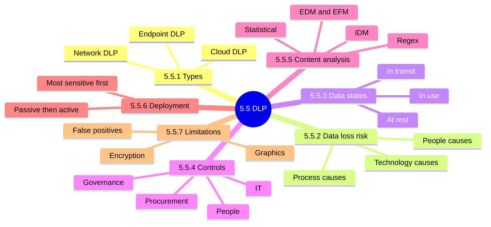
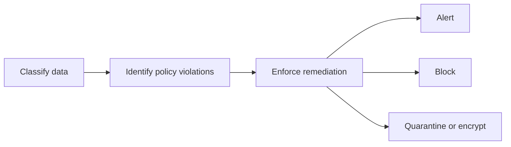
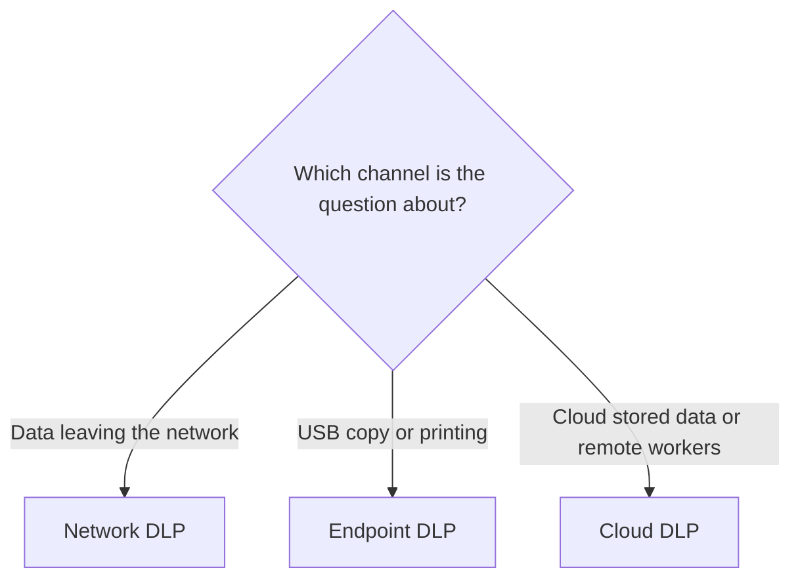
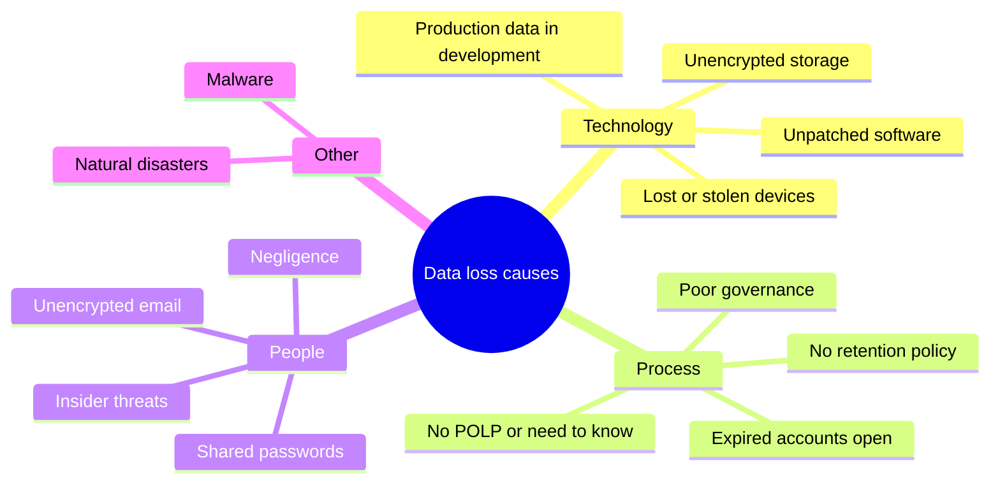
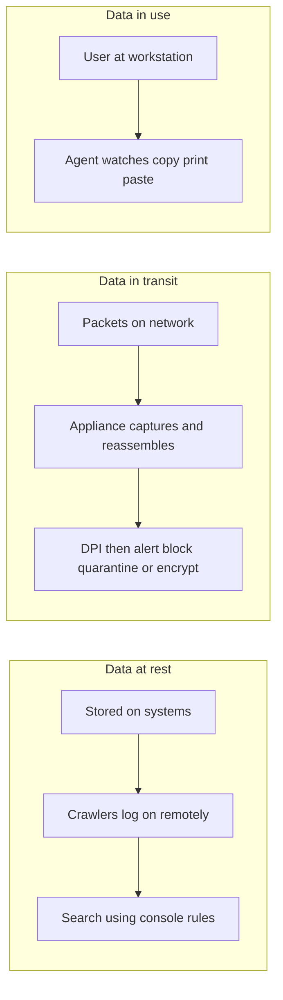
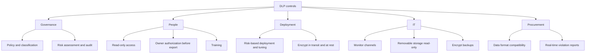
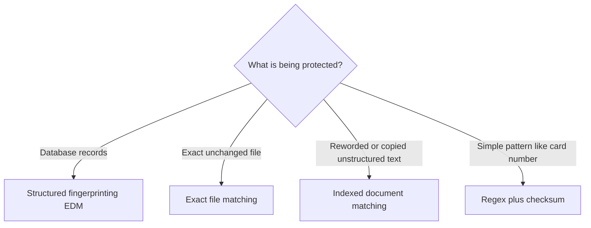
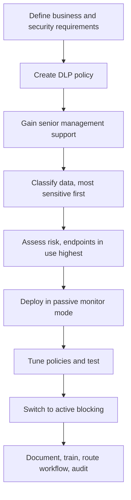
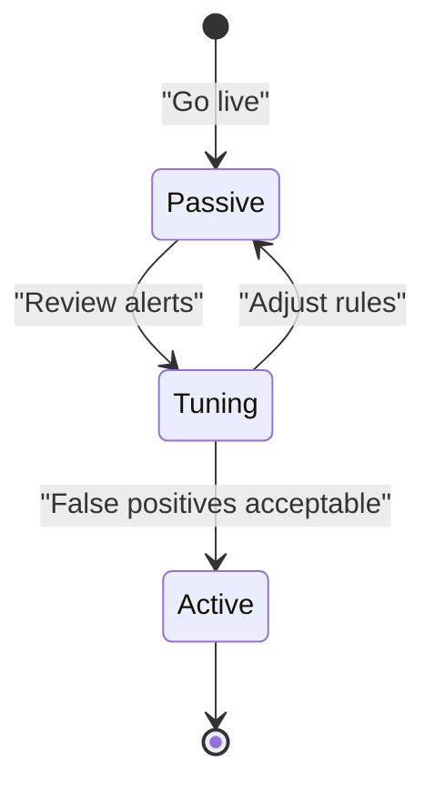
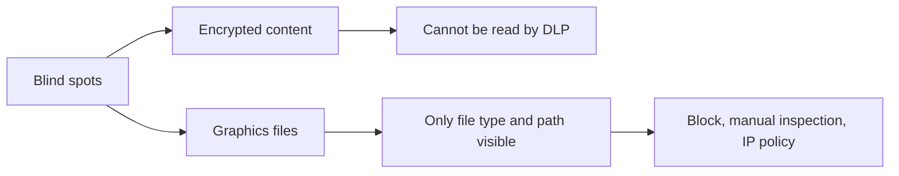

# 5.5 Data Loss Prevention (DLP) - Diagrams

[← Domain 5](../README.md) | [Study notes](../Study-Notes/5.5-Study-Notes.md)

### Section map

### 5.5.0 What DLP is

<b>Definitions and consequences of data loss</b>

- DLP: tools and processes that stop loss or misuse of sensitive data.
- Also called data leakage prevention.
- Consequence: reduced productivity, higher recovery costs, legal exposure.
- Consequence: lost customer trust, revenue, and possible business closure.
- Example: a clerk emails a customer list outside; DLP blocks it.

### 5.5.1 Types of DLP

| Type | Scans | Typical action | Mechanism |
|---|---|---|---|
| Network-based | Outgoing data | Alert, quarantine, encrypt | Deep packet inspection |
| Endpoint-based | Files on system and external devices | Block copy or print | Centrally managed agent |
| Cloud | Data stored in cloud | Remove sensitive attachment | Predefined data types |

<b>Exam traps</b>

- Network DLP does not see files copied to USB.
- Copy-to-USB and print control point to endpoint DLP.
- DLP distinction is payload inspection, not header-only inspection.

### 5.5.2 Data loss risk

<b>DLP use cases</b>

- Compliance: classify and tag data, monitor activity.
- Intellectual property protection against exfiltration.
- Data visibility across endpoints, network, and cloud.
- Pervasiveness across cloud and supply chain.
- Frequent breaches and value of stolen data.

<b>Exam traps</b>

- Most loss causes are people and process failures.
- Best response is the control targeting the cause, not new tools.

### 5.5.3 DLP solutions and data states

Data states: at rest, in transit (the manual's heading text calls it "data in motion"), in use.

| State | DLP technology | Example action |
|---|---|---|
| At rest | Crawlers | Find card numbers on file server |
| In transit | Network appliances with DPI | Block or encrypt outgoing file |
| In use | Endpoint agent | Stop copy to flash drive |

<b>Exam traps</b>

- Crawlers suit rest, agents suit in use, appliances suit transit.
- Encrypting stored data does not replace monitoring data in use.

### 5.5.4 DLP controls

<b>Exam traps</b>

- Policy and classification come before technology.
- Preventive controls beat detective ones to reduce loss.

### 5.5.5 DLP content analysis methods

| Method | Data type | Strength | Weakness |
|---|---|---|---|
| Regular expression | Patterns | First filter | High false positives without checksum |
| Structured fingerprinting EDM | Databases | Precise | Structured data only |
| Exact file matching EFM | Whole files | Low false positives | Fails on modified versions |
| Indexed document matching IDM | Unstructured | Detects derived content | Needs indexing |
| Lexicon | Unstructured | Finds concepts | Needs customization |
| Statistical | Any | Finds obscure data | Needs big data, noisy |
| Categorization | Prebuilt types | Quick compliance check | Fixed categories |

<b>Exam traps</b>

- Exact-match methods give few false positives but miss edited copies.
- Derived unstructured content points to IDM, not EFM.
- Structured database records point to EDM, not IDM.
- Checksum validation reduces regex false positives.
- Unverified: EFM weakness on modified versions is a flagged item in the notes (check).

### 5.5.6 DLP deployment best practices

<b>Passive vs active mode</b>

- Passive: leaks analyzed, not blocked.
- Active: blocks leakage and informs the administrator.
- Start passive, tune, then block.

<b>Exam traps</b>

- Begin with the most sensitive data, not all data.
- Management support and policy precede tool selection.

### 5.5.7 DLP risk, limitations and considerations

| Limitation | Mitigation |
|---|---|
| Improperly tuned network DLP | Monitor-only first, after-hours access path |
| Excess reporting and false positives | Customize rules, phased rollout |
| Encryption blocks inspection | See section 5.6 |
| Graphics cannot be interpreted | Identify file type, source, destination |

<b>Exam traps</b>

- Blocking immediately at go-live is wrong.
- More rules raise false positives, not protection.
- DLP does not remove the need for encryption and access control.

### Quick recall

| Fact | Answer |
|---|---|
| Three DLP types | Network, endpoint, cloud |
| Three data states | At rest, in transit, in use |
| Rest tool | Crawlers |
| Transit tool | Appliances with DPI |
| In-use tool | Endpoint agent |
| Exact data matching | Structured databases |
| Indexed document matching | Unstructured, derived content |
| Rollout order | Passive, tune, then active |
| Highest risk data | In use on endpoints |
| Blind spots | Encryption and graphics |
