# 5.6 Data Encryption - Diagrams

[← Domain 5](../README.md) | [Study notes](../Study-Notes/5.6-Study-Notes.md)

Items marked "(unverified)" carry a Check or unverified flag in the study notes.

### Section map

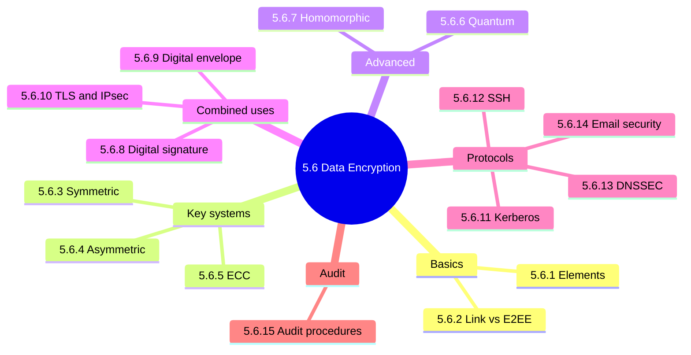

### 5.6 Overview of encryption

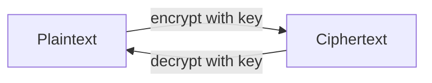

<details>
<summary><b>Uses and limits</b></summary>

- Protect data in transit and stored information.
- Deter and detect alteration.
- Verify authenticity of a transaction or document.
- Cannot prevent loss or modification of data.
- Key protection is the paramount concern.
- Subject to national laws and regulations.

</details>

<details>
<summary><b>Exam traps</b></summary>

- Strong algorithm with poorly protected keys is a weak control.
- Encryption does not guarantee availability.

</details>

### 5.6.1 Elements of encryption systems

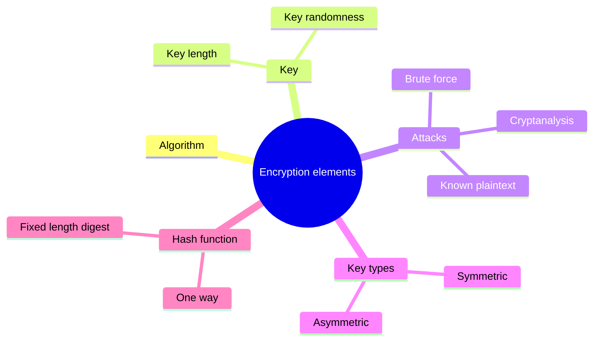

Symmetric vs asymmetric comparison:

| Feature | Symmetric | Asymmetric |
|---|---|---|
| Keys | One shared secret key | Public and private key pair |
| Key distribution | Hard, out of band | Easy, public key is open |
| Speed | Fast, bulk data | Slower, heavy computation |
| Signatures | Cannot sign documents | Supports signatures |
| Examples | AES, 3DES, RC4 | RSA, ECC |

Encryption vs hashing:

| Feature | Encryption | Hashing |
|---|---|---|
| Direction | Two-way | One-way |
| Output length | Variable | Fixed |
| Keys | Yes | No |
| Goal | Data security | Verification and authentication |
| Examples | AES, RC4, DES, RSA | SHA-1, SHA-2, MD5 |

Hashing and message integrity check:

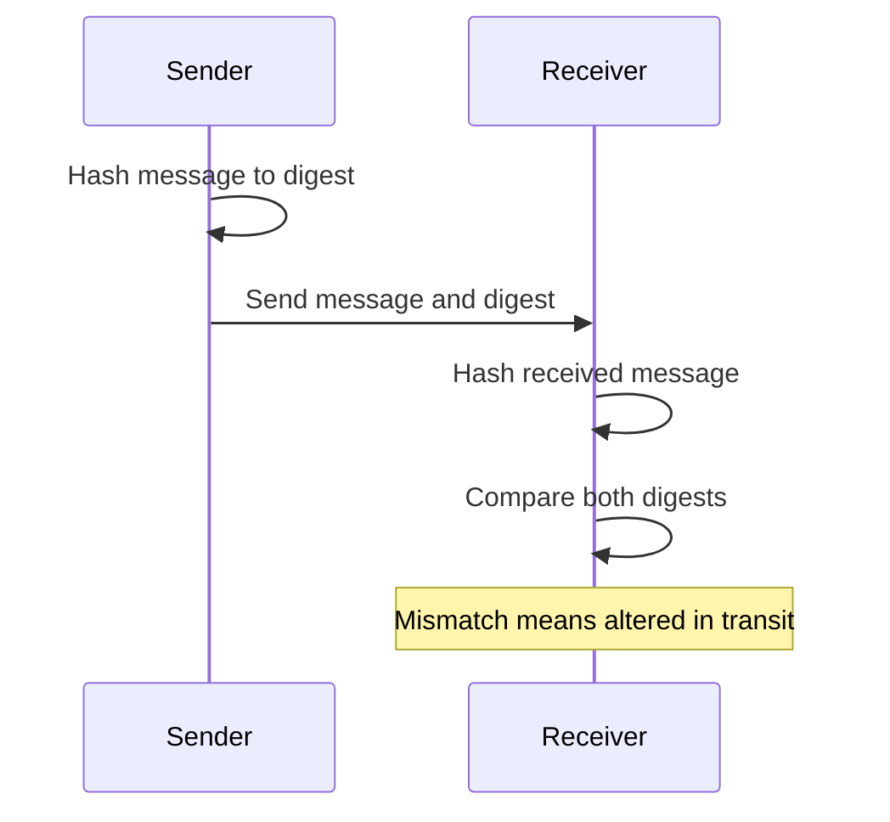

<details>
<summary><b>Hash facts</b></summary>

- MD5 gives 128 bits, SHA-1 160 bits, SHA-512 512 bits.
- Industry moving to SHA-2; NIST announced SHA-3.
- One changed bit changes the hash.
- Salt defends against dictionary and rainbow table attacks.
- Unverified: manual says specific digest algorithms are not tested.

</details>

<details>
<summary><b>Exam traps</b></summary>

- Hashing cannot be reversed, so it is not encryption.
- Hash alone proves integrity, not who sent the message.
- Longer key helps only if keys are truly random.

</details>

### 5.6.2 Link encryption vs end-to-end encryption

| Feature | Link encryption | End-to-end encryption |
|---|---|---|
| Scope | Whole channel including headers | Message only |
| Headers and routing | Encrypted | Not encrypted |
| Layers | Data link and physical | User chosen |
| Hops | Decrypt and re-encrypt each hop | Encrypted origin to destination |
| User role | Transparent to user | User chooses what to encrypt |
| Weakness | Hop key distribution and hop exposure | Routing data exposed |

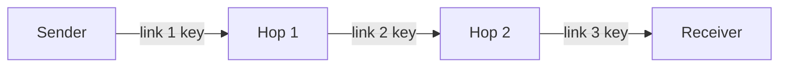

<details>
<summary><b>Exam traps</b></summary>

- Link encryption hides routing data, E2EE does not.
- User involvement signals E2EE, for example WhatsApp.
- Hop-by-hop decryption is the weakness of link encryption.

</details>

### 5.6.3 Symmetric key cryptographic systems

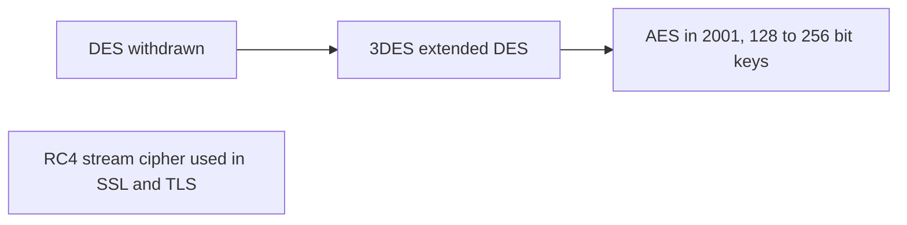

<details>
<summary><b>Pros and cons</b></summary>

- Advantage: shorter keys, less processing, ideal for bulk data.
- Disadvantage: key distribution is difficult.
- Disadvantage: shared secret cannot sign documents.

</details>

<details>
<summary><b>Exam traps</b></summary>

- Symmetric gives no nonrepudiation, two parties hold the key.
- Bulk data points to symmetric.

</details>

### 5.6.4 Public (asymmetric) key cryptographic systems

Key count comparison for N parties:

| Parties N | Asymmetric 2N keys | Symmetric N(N-1)/2 keys |
|---|---|---|
| 10 | 20 | 45 |
| 100 | 200 | 4950 |

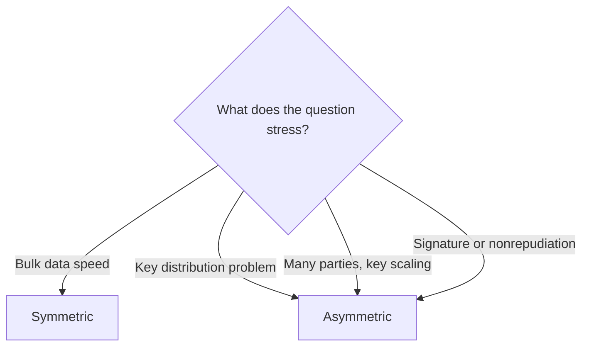

<details>
<summary><b>Details and unverified items</b></summary>

- Key pair works in one direction; two-way needs two pairs.
- RSA is the first practical system, keys 1024 to 4096 bits.
- RSA drawback: key length and heavy computation.
- Unverified: manual says about N squared symmetric keys; notes give N(N-1)/2.

</details>

<details>
<summary><b>Exam traps</b></summary>

- Public key encrypts for confidentiality, private key stays secret.
- Asymmetric scales better, symmetric is faster for bulk data.

</details>

### 5.6.5 Elliptic curve cryptography

| Feature | RSA | ECC |
|---|---|---|
| Math basis | Prime factorization | Elliptic curves over finite fields |
| Key size for equal security | Larger | Considerably smaller |
| Bandwidth | Higher | More savings |
| Speed | Slower | Fast generation, agreement, signatures |

<details>
<summary><b>Exam traps</b></summary>

- Smaller key does not mean weaker security.
- ECC is asymmetric, not symmetric.
- Unverified: mobile device suitability is general industry knowledge.

</details>

### 5.6.6 Quantum cryptography

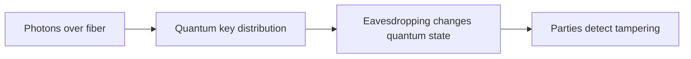

| Benefits | Limitations |
|---|---|
| Security by laws of physics | Polarization may change |
| Detects eavesdropping | Range about 500 km |
| Variety of protocols | High implementation cost |
| Simple to operate | No multiplexing, one channel per destination |

<details>
<summary><b>Exam traps</b></summary>

- It detects eavesdropping, it does not make interception impossible.
- Limits are cost and range, not weak security.
- Unverified: 500 km is a general limit, some vendors exceed it.

</details>

### 5.6.7 Homomorphic encryption

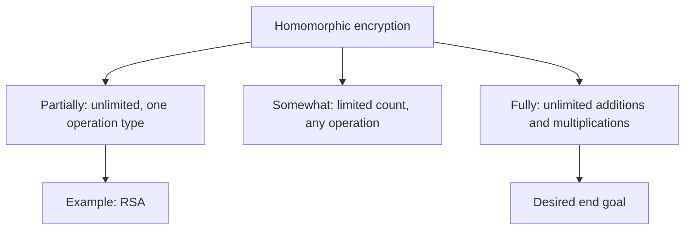

<details>
<summary><b>Benefits and challenges</b></summary>

- Benefits: supply chain, cloud, data security, GDPR, analytics, privacy.
- Challenge: inefficiency and reduced performance.
- Challenge: high storage needs and inability to scale.
- Challenge: large complex algorithms.

</details>

<details>
<summary><b>Exam traps</b></summary>

- Processing happens without decrypting, cost is performance.
- Partial means one type unlimited, somewhat means limited count.

</details>

### 5.6.8 Digital signatures ⭐

Digital signature flow:

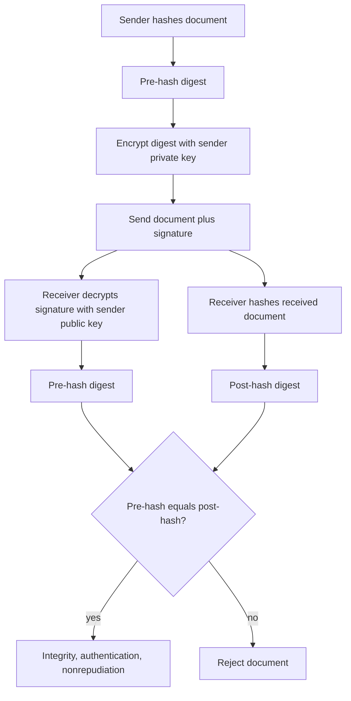

Signature sequence (sender signs, receiver verifies):

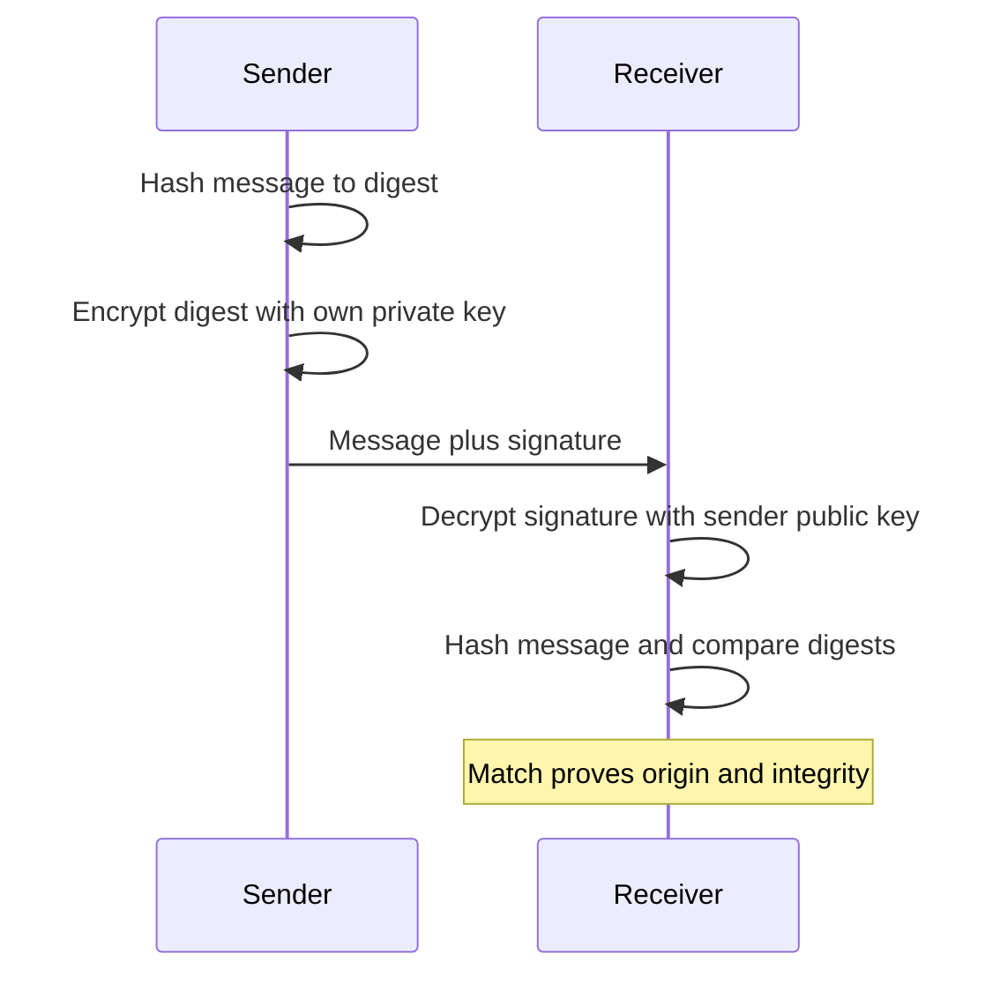

Confidentiality sequence (public key encrypts):

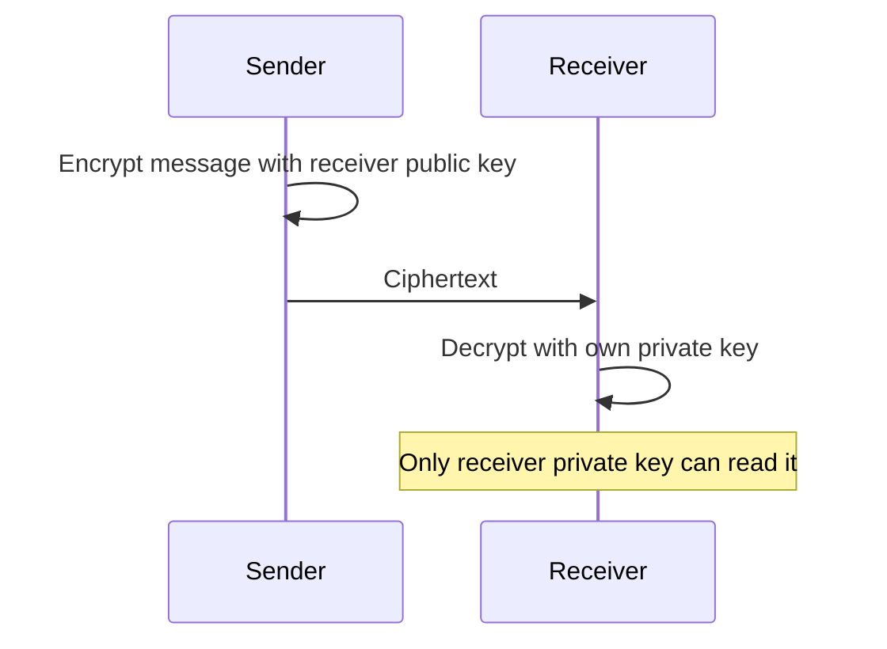

<details>
<summary><b>Guarantees and replay</b></summary>

- Integrity: any change alters the hash.
- Authentication: only the sender holds the private key.
- Nonrepudiation: sender cannot deny generating it. 📓⭐
- Replay attack: resent signed document, stopped by timestamp or counter.
- Signing the digest avoids heavy processing of the whole document.

</details>

<details>
<summary><b>Exam traps</b></summary>

- Signature gives no confidentiality.
- Sign with sender private key, verify with sender public key.
- Nonrepudiation needs asymmetric keys.

</details>

### 5.6.9 Digital envelope

Combined (hybrid) sequence:

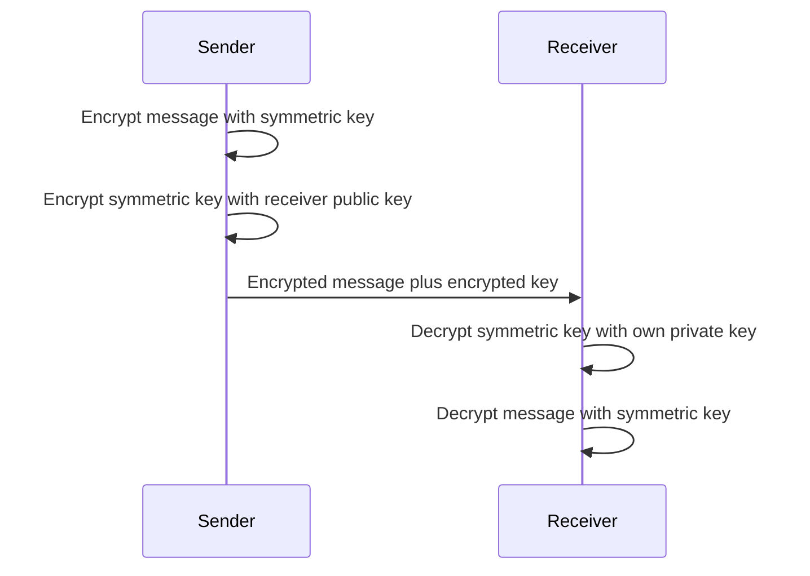

<details>
<summary><b>Details</b></summary>

- Combines symmetric speed with asymmetric key distribution.
- Example: Pretty Good Privacy, PGP.
- Exam trap: the envelope encrypts the key asymmetrically, never the bulk message.

</details>

### 5.6.10 Applications of cryptographic systems

TLS handshake overview:

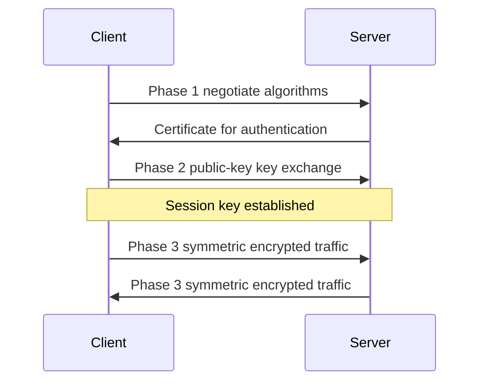

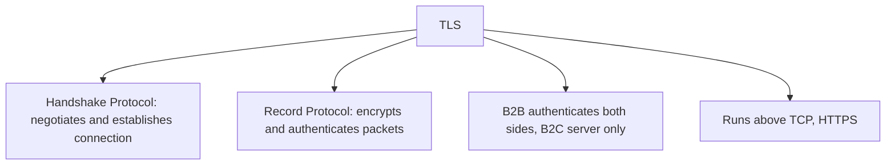

IPsec flow and modes:

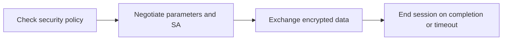

| Item | Detail |
|---|---|
| Transport mode | Encrypts ESP payload, the data |
| Tunnel mode | Encrypts ESP payload and header |
| ESP | Carries encrypted data portion |
| AH | Manual says adds nonrepudiation, flagged (unverified) |
| SA | One-way connection, 32-bit SPI |
| ISAKMP and IKE | ISAKMP manages SAs, IKE does key management |

<details>
<summary><b>Details and unverified items</b></summary>

- Combined scheme: fresh secret key per limited data amount.
- Underlies SSL/TLS and S/MIME.
- TLS replaced SSL after a 2014 vulnerability.
- Unverified: AH is normally authentication and integrity, not true nonrepudiation.
- Unverified: RC4, SHA-1, Fortezza listed in manual are dated.

</details>

<details>
<summary><b>Exam traps</b></summary>

- Transport mode protects data only, tunnel also hides original header.
- IPsec is network layer, SSH and TLS work above it.

</details>

### 5.6.11 Kerberos

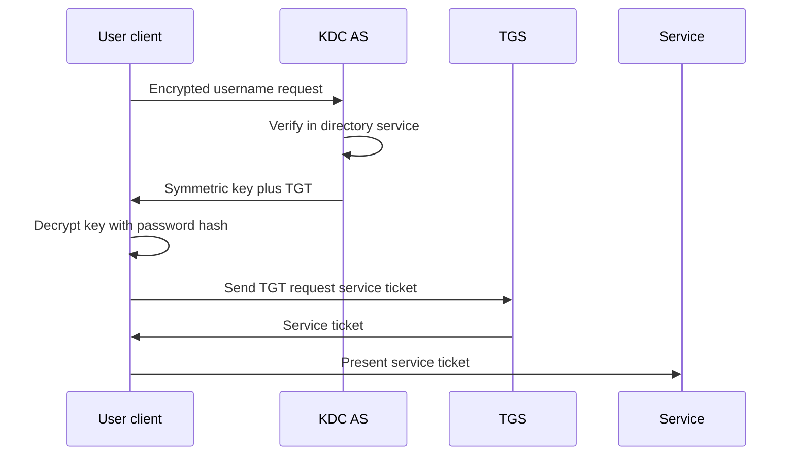

<details>
<summary><b>Components and risks</b></summary>

- KDC: trusted third party holding all secret keys.
- TGS validates ticket use, AS checks authenticity and timeliness.
- Password never sent over the network.
- Risk: KDC single point of failure.
- Risk: clock drift invalidates the TGT.

</details>

<details>
<summary><b>Exam traps</b></summary>

- Weakness is KDC concentration and time sync, not password transmission.
- Clock drift causes access denial, not corruption.

</details>

### 5.6.12 Secure Shell (SSH)

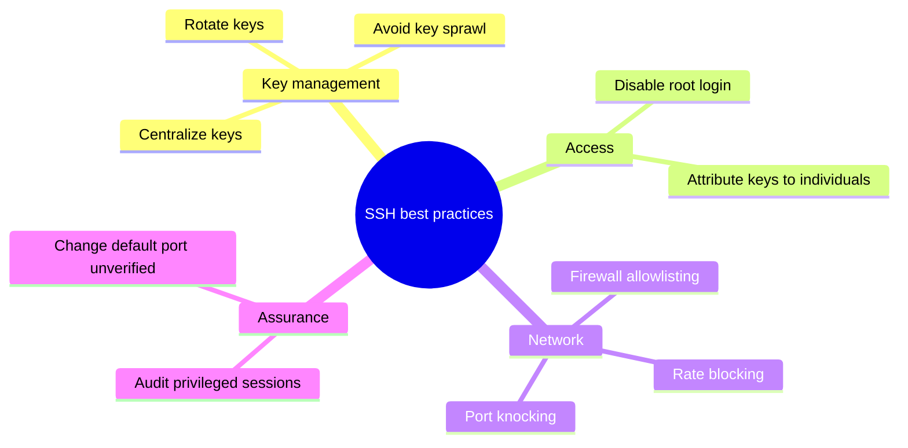

<details>
<summary><b>Details</b></summary>

- Replaced Telnet, which sent passwords in clear text.
- Application layer, client-server.
- Uses: remote logon, file transfer, remote commands, support.
- Unverified: changing default port is obscurity, weak alone.
- Exam trap: shared SSH accounts destroy accountability.

</details>

### 5.6.13 DNS Security Extensions (DNSSEC)

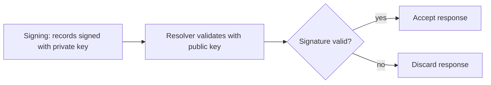

| Provides | Prevents | Vulnerabilities |
|---|---|---|
| Origin authentication | DNS cache poisoning | DDoS amplification |
| Authenticated denial of existence | DNS false zones | Larger query responses |
| Data integrity | | UDP reliance, no handshake (unverified) |

<details>
<summary><b>Exam traps</b></summary>

- DNSSEC proves authenticity and integrity, it does not encrypt queries.
- DNSSEC can raise DDoS amplification risk.
- Unverified: manual blames UDP, DNS generally uses UDP with TCP fallback.

</details>

### 5.6.14 Email security

Attacks:

| Attack | Meaning |
|---|---|
| Bombing | Repeated identical messages |
| Spamming | Unsolicited bulk email |
| Spoofing | Forged sender |
| BEC | Targets staff who authorize payments |

Technologies and controls:

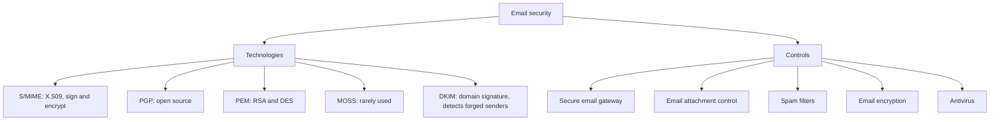

DKIM flow, as far as the notes cover it:

```mermaid
sequenceDiagram
    participant S as Sending domain
    participant R as Receiving server
    S->>S: Sign mail for domain owner
    S->>R: Signed email
    R->>R: Check signature
    Note over R: Failure suggests forged sender
```

<details>
<summary><b>SPF, DKIM, DMARC coverage</b></summary>

- SPF is named as a way to manage spam.
- Unverified: manual writes "Sender Permitted Framework", standard is Sender Policy Framework.
- DKIM signs mail to show the domain owner authorized it.
- DMARC is not covered in the notes, so it is left out.

</details>

<details>
<summary><b>Exam traps</b></summary>

- Digital signature gives sender proof, encryption gives confidentiality.
- Training addresses BEC better than filters alone.
- Responding to spam validates the address.

</details>

### 5.6.15 Encryption audit procedures

Key management lifecycle, as listed in the audit procedures:

```mermaid
stateDiagram-v2
    [*] --> Creation: "Follow policy"
    Creation --> Transmission: "Written procedure"
    Transmission --> InUse: "Authorized changes only"
    InUse --> Rotation: "Per policy"
    Rotation --> InUse: "New key"
    InUse --> Destruction: "End of life"
    Destruction --> [*]
```

```mermaid
flowchart TD
    A["Encryption audit"] --> B["Policy"]
    A --> C["Design"]
    A --> D["Key management"]
    A --> E["Digital signature keys"]
    B --> B1["Written policy, classification, risk assessment"]
    B --> B2["Dual control and separation of duties"]
    C --> C1["Documented algorithm choice, respected standards"]
    D --> D1["Authorized changes only"]
    D --> D2["Users and operators do not handle keys"]
    E --> E1["Private keys never backed up"]
    E --> E2["Separate pairs for encryption and signing"]
```

```mermaid
flowchart TD
    Q{"Scenario"}
    Q -->|"Device physically lost or stolen"| F["Full disk encryption"]
    Q -->|"Data crossing untrusted network"| V["VPN or transit encryption"]
```

<details>
<summary><b>Exam traps</b></summary>

- Backing up signing private keys increases exposure.
- Users handling keys breaks separation of duties.
- Unverified: manual wording on deciphering cost reversed, attacker cost should exceed information value.

</details>

### Quick recall

| Fact | Answer |
|---|---|
| Signature gives ⭐ | Integrity, authentication, nonrepudiation |
| Signature keys | Sign with private, verify with public |
| Confidentiality | Encrypt with receiver public key |
| Digital envelope | Symmetric message, public-key-encrypted key |
| TLS phases | Negotiate, key exchange, symmetric traffic |
| Symmetric | Fast, bulk, hard key distribution |
| Asymmetric | Solves key distribution, slower |
| Kerberos risks | KDC single point of failure, clock drift |
| Lost laptop 📓⭐ | Full disk encryption |
| Signing private keys | Never backed up |
