# 5.7 Public Key Infrastructure (PKI) - Diagrams

[← Domain 5](../README.md) | [Study notes](../Study-Notes/5.7-Study-Notes.md)

Markers: 📓 in my notes, ⭐ frequently tested, ➕ / ⚠ Check = unverified (shown as "unverified").

### Section map

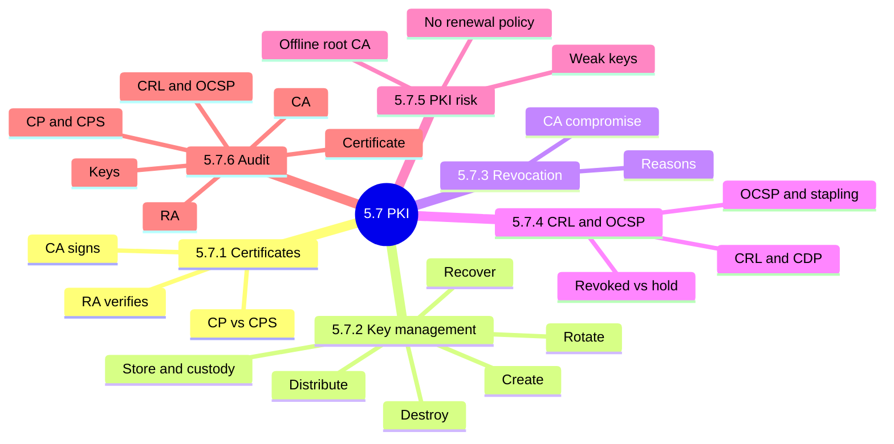

### 5.7.1 Digital certificates

PKI components and how they relate:

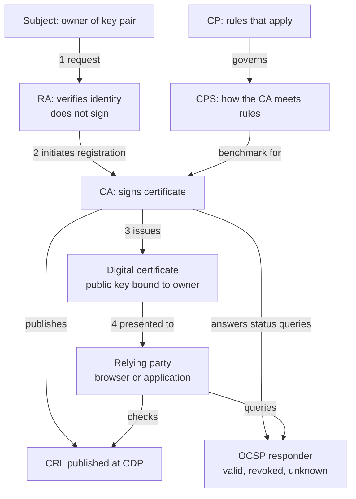

Certificate issuance sequence:

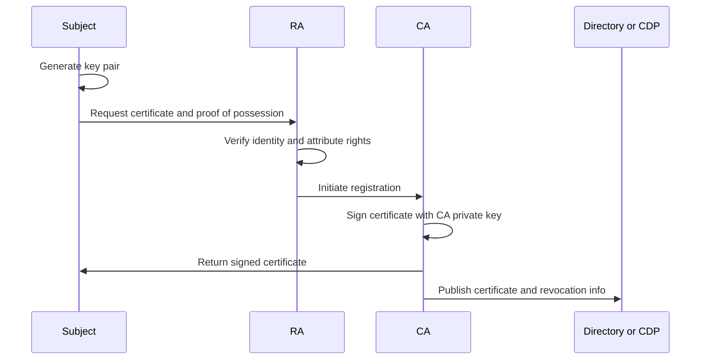

Certificate validation sequence:

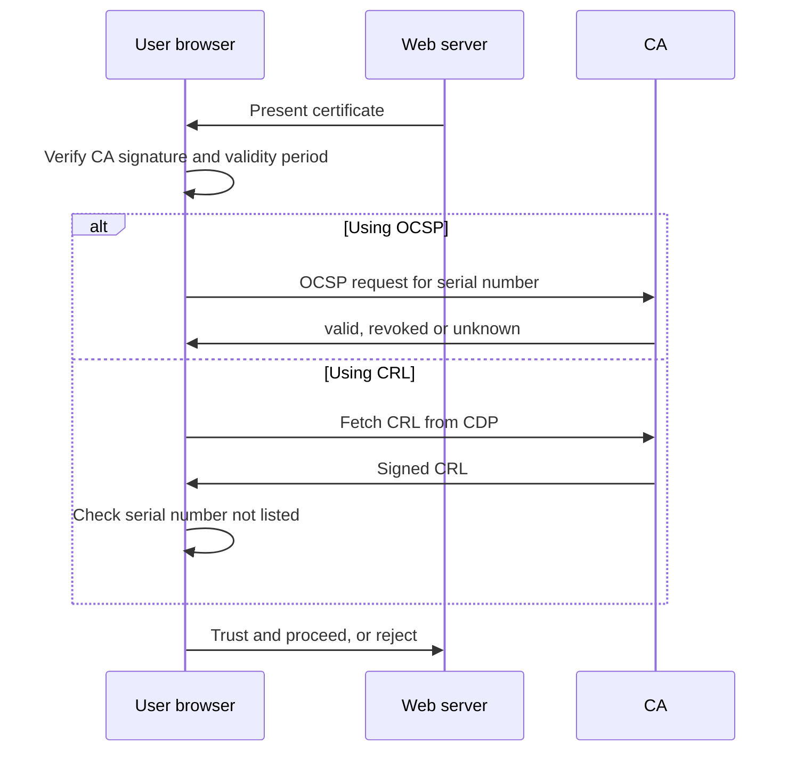

<b>CP vs CPS and RA roles</b>

- CP: names PKI actors, roles, duties and responsibilities.
- CP: sets certificate use, key generation and name selection.
- CPS: how a specific CA actually issues certificates.
- CPS: certificate types, issue, renew, recover policies.
- CPS: algorithms, key length, lifetime, revocation and CRL policies.
- RA: verifies subject information and right to attributes.
- RA: verifies proof of possession of the private key.
- RA: reports key compromise, assigns names, generates shared secrets.
- RA: initiates registration and key recovery with the CA.
- RA: distributes physical tokens such as smart cards.

<b>Exam traps</b>

- CP says what rules apply; CPS says how the CA meets them.
- Signing certificates is the CA's job, never the RA's.
- Proof of possession means the requester truly holds the private key.
- A certificate is only as trustworthy as its signing CA.

<b>Example</b>

- A browser trusts a bank site because a trusted CA signed it.
- National branches of a global firm act as RAs for local staff.

### 5.7.2 Key management

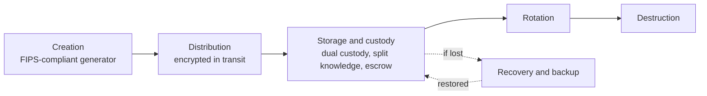

Key states:

| State | Meaning |
|---|---|
| Suspended | Temporary hold |
| Revoked | No reinstatement possible |
| Expired | Inactive until renewed |
| Destroyed | Permanently gone |

<b>Definitions</b>

- Dual custody: two or more people needed to access a key.
- Split knowledge: key parts divided so no one knows all.
- Key escrow: trusted party holds a copy for later recovery.
- Rotation: retire old keys, put new keys in use.

<b>Exam traps</b>

- Escrow aids recovery but adds a point of compromise.
- Weak key handling defeats even very strong algorithms.
- Destruction must leave no recoverable key data.
- ⚠ Check (unverified): manual lists destroyed among key states; revoked is not the same.

### 5.7.3 Certificate revocation

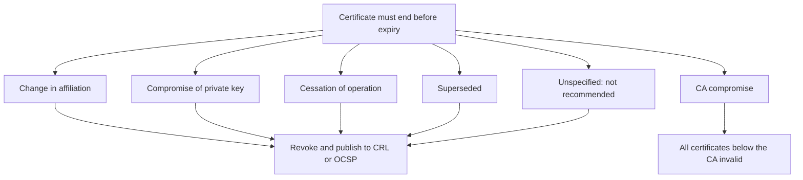

<b>Exam traps</b>

- Revoking a CA is far wider than revoking one certificate.
- Unspecified reason removes the audit trail.
- ⚠ Check (unverified): manual ties cessation to CA decommissioning.

<b>Example</b>

- A stolen laptop exposes every private key stored on it.

### 5.7.4 Certificate Revocation List (CRL)

Certificate lifecycle states:

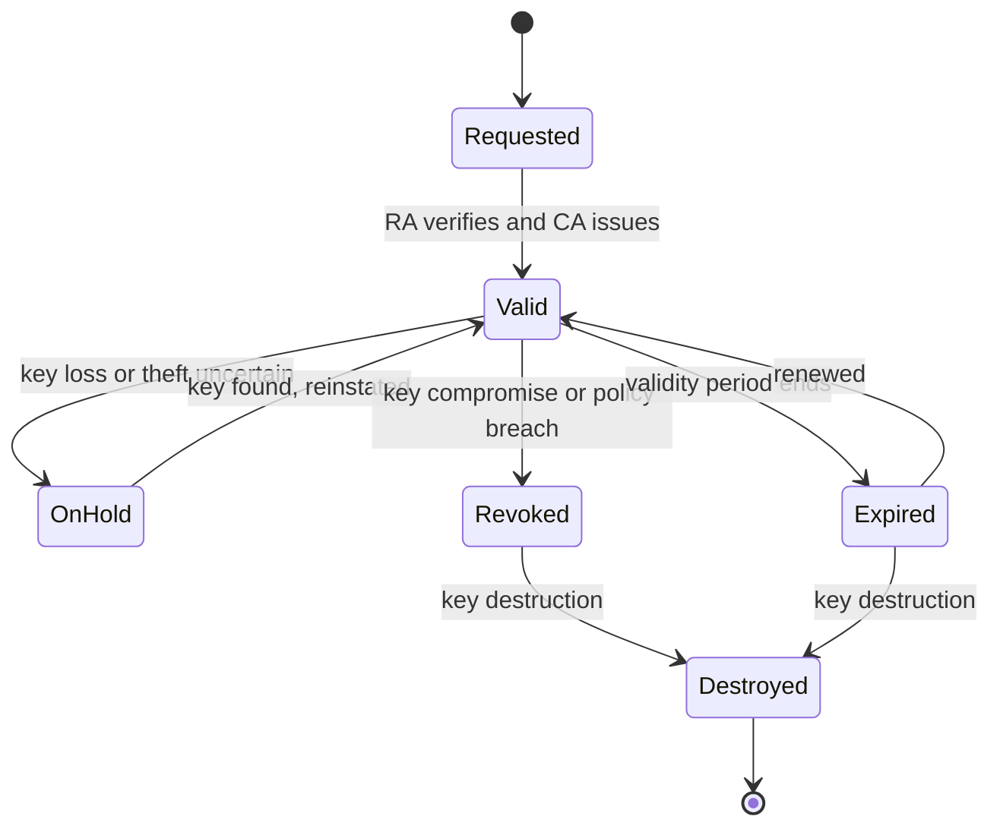

CRL versus OCSP:

| Aspect | CRL | OCSP |
|---|---|---|
| Delivery | Periodic list from CDP | Per-certificate query |
| Freshness | As of last issue | Real-time |
| Answer | Serial listed or not | Valid, revoked, unknown |
| Note | CDP is LDAP or web server | Stapling adds speed, privacy |

OCSP stapling:

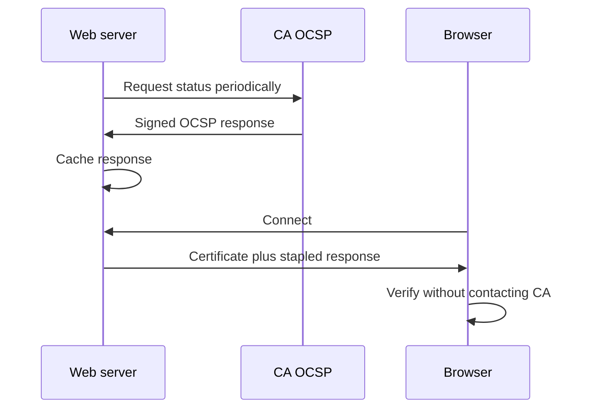

<b>CRL contents</b>

- Issuer name, revocation date and time.
- Reasons, extensions, signature algorithm.
- Certificate serial number.
- Date next CRL will be issued.
- ⚠ Check (unverified): manual also lists a revocation time period item.

<b>Exam traps</b>

- Only hold can be reversed; revoked never returns to valid.
- Stapling enhances OCSP; it does not replace CRLs.
- Stale or unreachable CRLs keep revoked certificates trusted.

<b>Example</b>

- User unsure about a lost key puts the certificate on hold.
- Key found unused, so the certificate is reinstated.
- With stapling, the CA sees requests per website, not per user.

### 5.7.5 PKI infrastructure risk

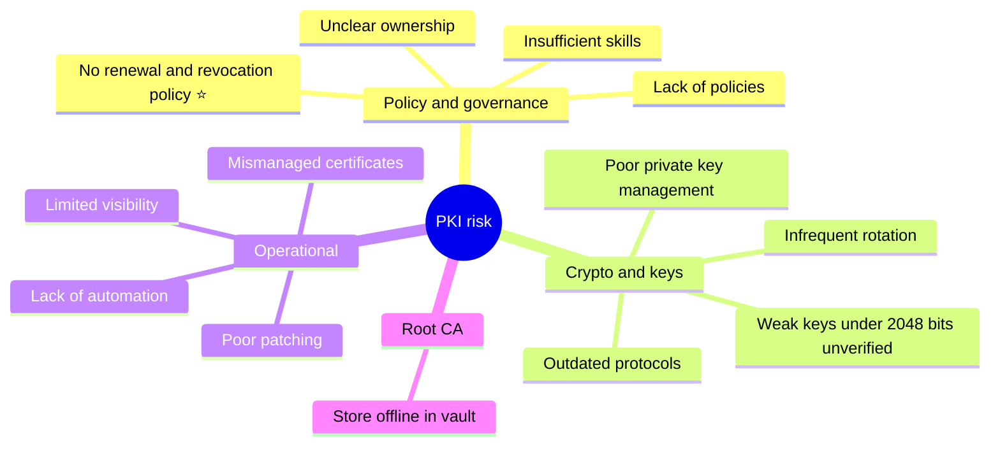

Exam logic:

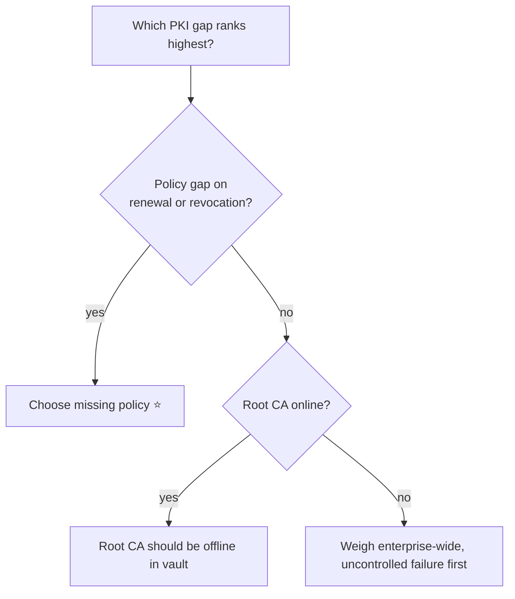

<b>Exam traps</b>

- No clear renewal and revocation policy is the biggest concern 📓⭐.
- Online, always-on root CAs are the wrong design.
- Multiple CAs are not inherently a defect; unmanaged ones may be.
- ⚠ Check (unverified): 2,048-bit threshold is manual-stated; confirm against current standards ➕.
- ⚠ Check (unverified): manual repeats key-length sentence under rotation; likely editing slip.

<b>Example</b>

- An expired certificate causes outages and opens lateral movement paths.

### 5.7.6 Audit procedures for PKI

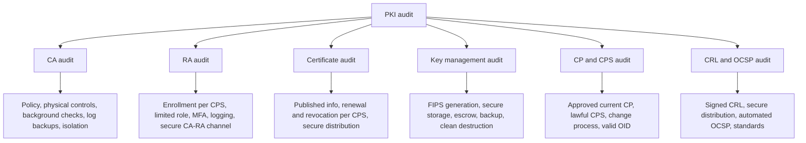

<b>Exam traps</b>

- An RA given extra roles is a segregation-of-duties finding.
- Removing a revoked entry early could let it be trusted again.
- Revoked entries stay listed until the validity period ends.
- ⚠ Check (unverified): manual says OCSP replaces annual CRL review; wording unclear.

### Quick recall

| # | Fact |
|---|---|
| 1 ⭐ | No clear renewal and revocation policy is the top PKI risk 📓 |
| 2 | CA signs certificates; RA verifies identity only |
| 3 | CP states rules; CPS states how the CA follows them |
| 4 | Revoked is permanent; hold is reversible |
| 5 | OCSP gives real-time status; stapling adds speed and privacy |
| 6 | Revoking a CA invalidates everything beneath it |
| 7 | Store root CA offline in a vault |
| 8 | Key life cycle: create, distribute, store, rotate, recover, destroy |
| 9 | Weak keys under 2,048 bits (unverified, manual-stated) |
