# 5.8 Cloud and Virtualized Environments - Diagrams

[← Domain 5](../README.md) | [Study notes](../Study-Notes/5.8-Study-Notes.md)

Markers: 📓 in my notes, ⭐ frequently tested, ➕ / ⚠ Check = unverified (shown as "unverified").

### Section map

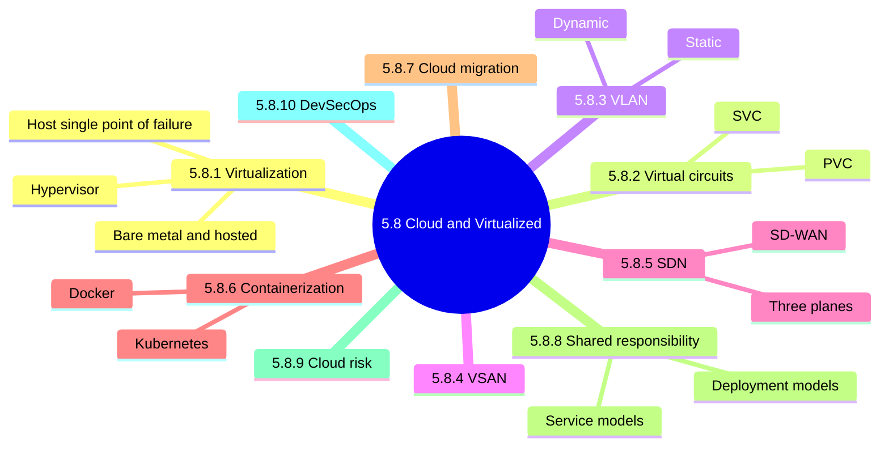

Virtualization versus cloud:

| Aspect | Virtualization | Cloud |
|---|---|---|
| Idea | Physical resources become virtual | Virtual resources on demand over Internet |
| Relationship | Can exist alone | Always builds on virtualization |

### 5.8.1 Virtualization

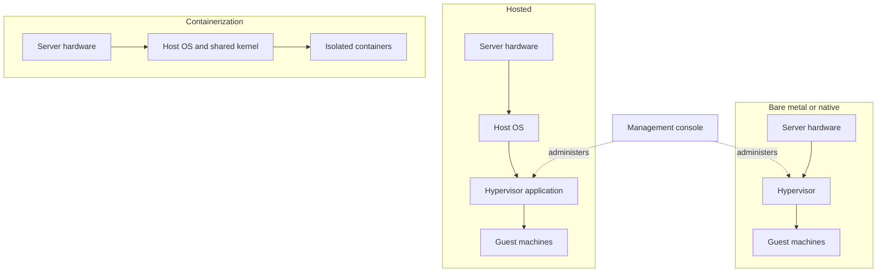

Risk and control view:

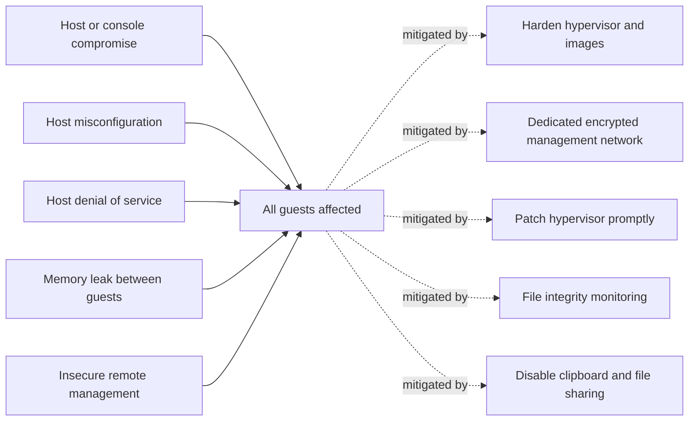

<b>Advantages and disadvantages</b>

- Lower hardware and operating costs; smaller footprint.
- Duplicate guests support business continuity.
- Separate cost-effective development and test environments.
- One host access control covers many guests.
- Host is a potential single point of failure.
- Console compromise grants guest access.

<b>Higher-level risk and controls</b>

- Hypervisor rootkit can sit below the guest OS.
- Snapshots hold RAM contents and sensitive data.
- Guest tools can become an attack vector.
- Host update does not update VMs.
- Keep VMs out of the DMZ.
- Sync to a trusted timeserver; disconnect unused hardware.
- Strong change management; backups and periodic snapshots.

<b>Exam traps</b>

- Virtualization consolidates risk onto the host; it does not remove it.
- Guest data leakage: host must control memory allocation.
- Management console is the most critical control point.
- Bare metal has smaller attack surface than hosted.

### 5.8.2 Virtual circuits

| Aspect | PVC | SVC |
|---|---|---|
| Availability | Always, like leased line | On demand, then torn down |
| Exposure | Longer | Shorter |
| Monitoring | More needed | Less needed |
| Security | Not insecure by nature | More secure |

<b>Exam traps</b>

- SVC is the more secure choice: shorter exposure.
- PVC needs more monitoring; it is not insecure by nature.

### 5.8.3 Virtual Local Area Network (VLAN)

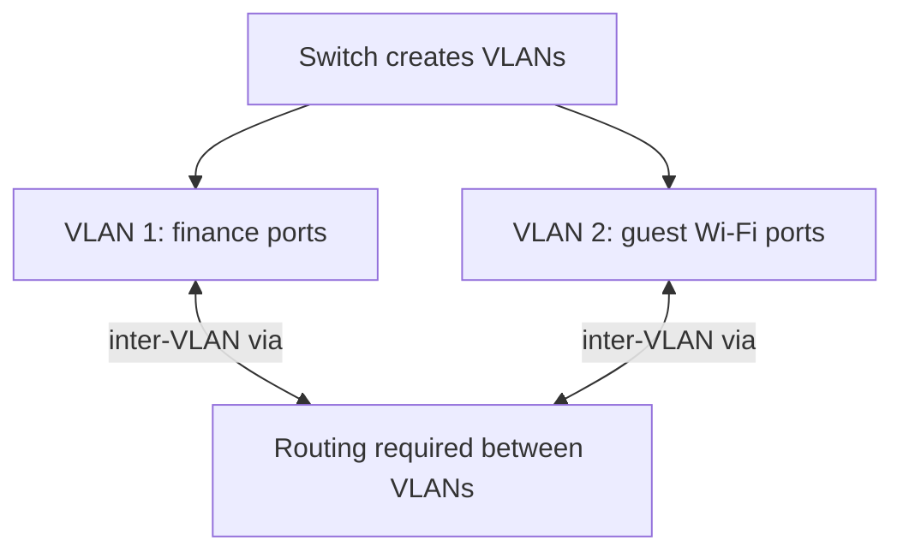

| Type | Membership by |
|---|---|
| Static (port-based) | Switch port |
| Dynamic | Negotiation, IP or hardware address |

<b>Uses and exam traps</b>

- Uses: restrict broadcasts, isolate traffic, reduce sniffing.
- Stops broadcast storms.
- Same-VLAN ports communicate freely.
- VLANs are not subnets: switches vs IP masks.
- A VLAN alone does not encrypt traffic.

### 5.8.4 Virtual Storage Area Networks (VSAN)

| Aspect | SAN | VSAN |
|---|---|---|
| Hardware | Dedicated hardware | Uses host resources |
| Scaling | Difficult | Allocated dynamically |
| Cost | Costly | Less costly |

<b>Benefits and exam traps</b>

- Suits cloud, VDI, backup and archiving, DR.
- Benefits: cost, scalability, performance, flexibility, security, simplicity.
- Flexibility: block and file storage.
- Security: replication and snapshots.
- Embedded in the hypervisor.
- VSAN partitions storage logically, not a separate physical network.

### 5.8.5 Software-Defined Networking (SDN)

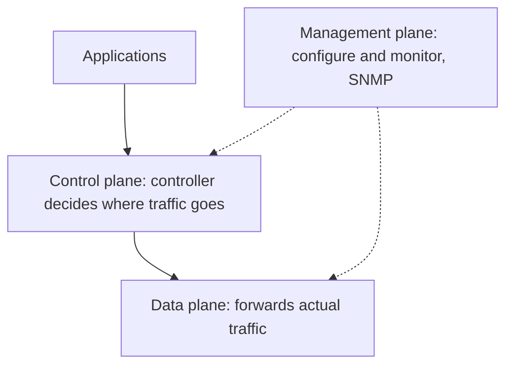

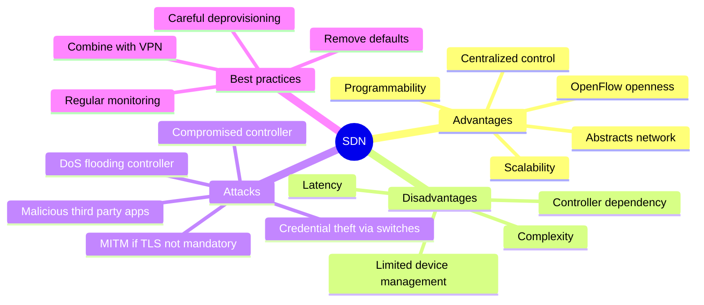

<b>SD-WAN and exam traps</b>

- SD-WAN links distributed locations; often vendor-managed.
- SD-WAN reliance on vendor adds third-party risk.
- Controller compromise affects the whole network; protect it first.
- Mandatory TLS is the fix for man-in-the-middle.
- SDN is virtualization, not a security solution.

### 5.8.6 Containerization

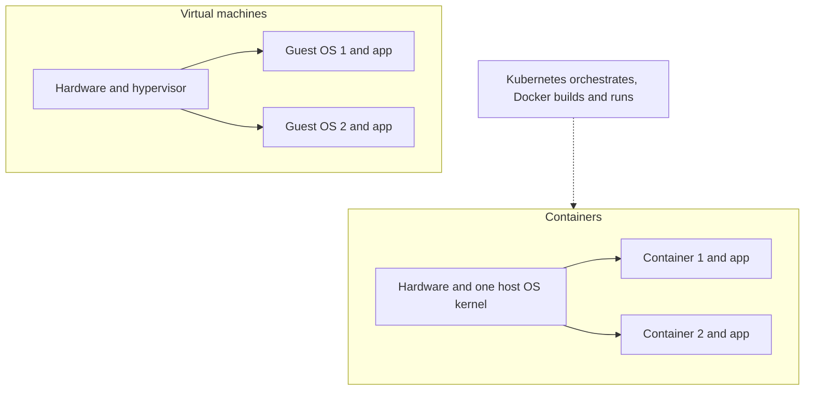

| Aspect | VMs | Containers |
|---|---|---|
| Isolation | Full | Lightweight |
| Operating system | Full OS each | Share host OS |
| Orchestration | Manual or hypervisor tools | Automated, such as Kubernetes |

Exam logic:

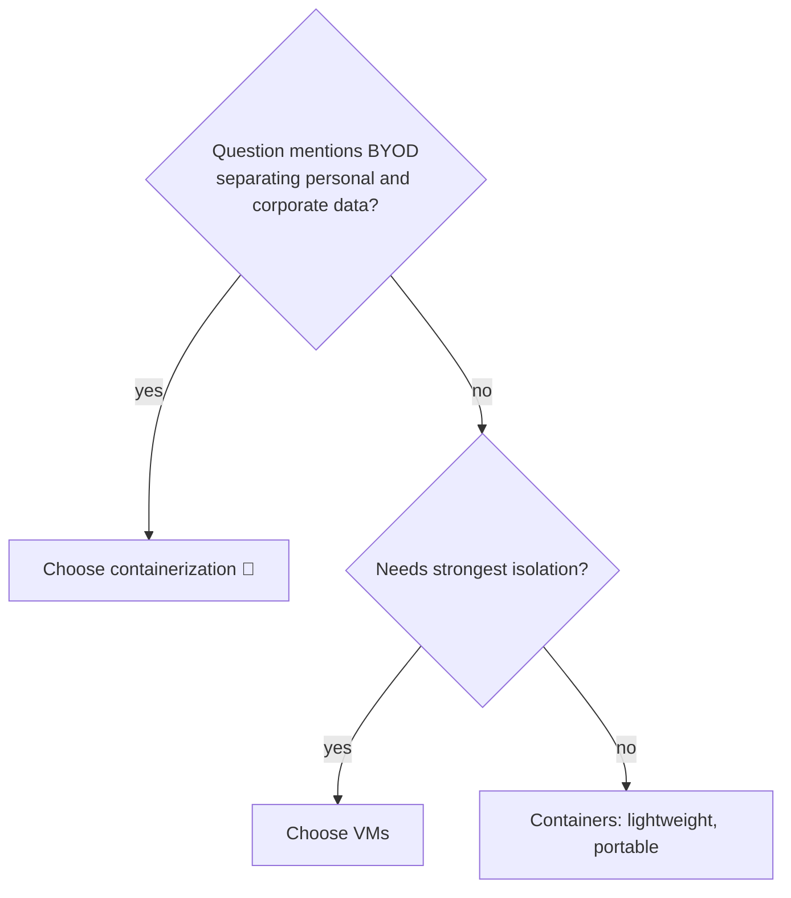

<b>Benefits, limits, best practices</b>

- Benefits: faster deployment, portable, platform-agnostic, scalable.
- Best supported on Linux.
- Kernel vulnerability affects all containers.
- Networking needs a network bridge; monitoring is hard.
- Patch: update base image, rebuild application image.
- Run containers on a VM for added isolation.
- Forensics limited once a container is replaced.
- Secure management stack with least privilege.
- Packaging app with own libraries is unverified ➕.

### 5.8.7 Secure cloud migration

```mermaid
flowchart LR
    M1["Develop migration plan"]
    M2["Assess current security"]
    M3["Set standards, map requirements"]
    M4["Train employees"]
    M5["Evaluate regulations and target data center"]
    M6["Encrypt in transit with TLS"]
    M7["Strict access control"]
    M8["Automate and back up"]
    M9["Monitor with CSPM"]
    M1 --> M2 --> M3 --> M4 --> M5 --> M6 --> M7 --> M8 --> M9
```

| Migration form |
|---|
| On-premises to cloud |
| Cloud to cloud |
| Reverse migration, cloud to on-premises |

<b>Risks and exam traps</b>

- Multi-tenancy, API vulnerabilities, compliance risk.
- Uncontrolled growth, data loss, reduced visibility.
- Data remanence: residual data after deletion or move.
- Talent gap; incompatible existing architecture.
- Plan and assess security before moving data.
- Migration does not transfer accountability to the provider.
- Remove secrets from pipeline code.

### 5.8.8 The shared responsibility model

Shared responsibility table:

| Party | Responsible for |
|---|---|
| Provider | Infrastructure, virtualization layer, hardware, physical data centers |
| Customer | Data, guest OS, IAM, encryption, policies, firewalls |
| Shared | Training, patch management, configuration management |

Service models:

| Model | What the provider gives | Customer role |
|---|---|---|
| IaaS | Processing, storage, networks | Controls OS and applications |
| PaaS | Development sandbox | Builds applications |
| SaaS | Complete applications via thin client | Uses app; keeps data and access |

Customer responsibility shrinks from IaaS to SaaS but never vanishes.

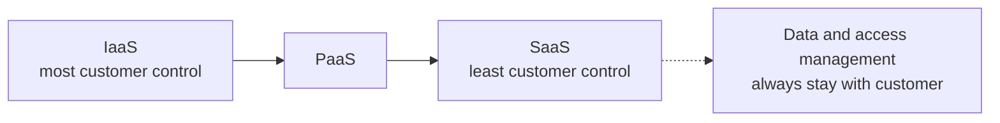

Deployment models comparison:

| Model | Key point |
|---|---|
| Public | Provider secures the cloud; customer secures in the cloud |
| Private | Dedicated infrastructure; more control; healthcare, finance |
| Hybrid | Customer segments data by use case |
| Community ⭐📓 | Consortium shares compliance; member-managed; high data security |
| Multi-cloud | Several public clouds; larger attack surface |

Hybrid note (unverified): manual wording calls hybrid "private and private"; likely a typo for public plus private (⚠ Check).

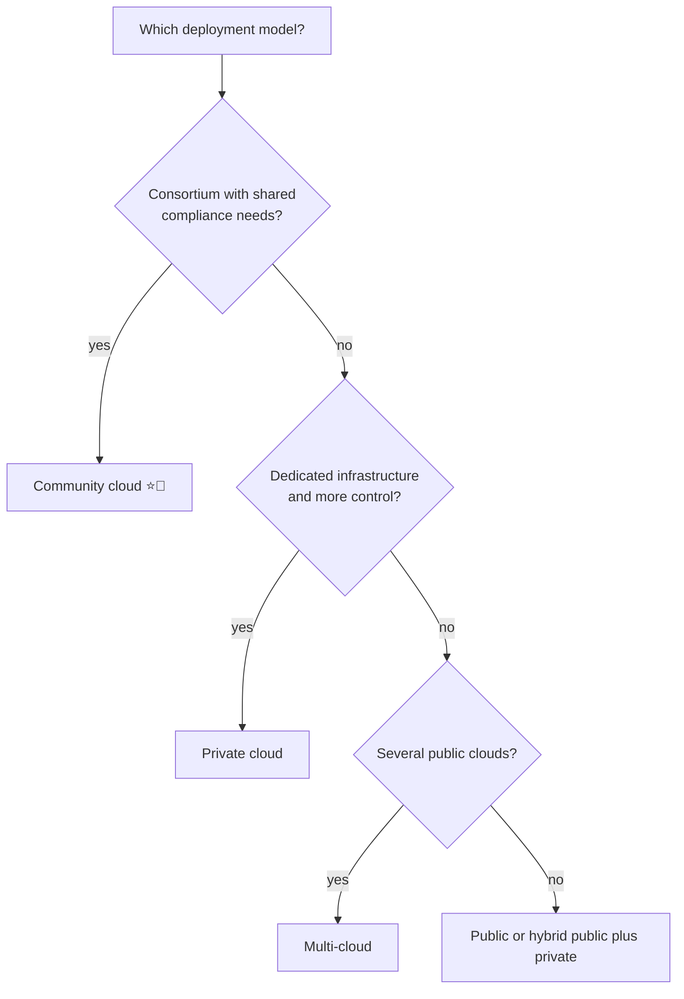

<b>Best practices and exam traps</b>

- Review the SLA carefully for security duties.
- Prioritize data security; ensure robust IAM.
- Identify a trusted cybersecurity partner; embrace DevSecOps.
- Customer cannot transfer data security or GRC risk.
- Consortium with shared compliance means community, not hybrid.
- Hybrid is public plus private, not several public clouds (see unverified note).

<b>Example</b>

- Regional hospitals needing shared compliance controls use a community cloud.

### 5.8.9 Key risk in cloud environments

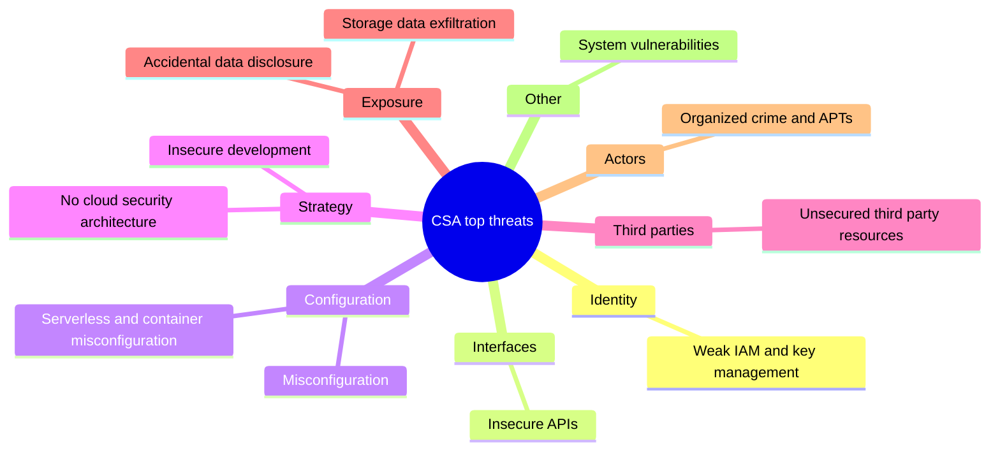

<b>Exam traps</b>

- Customer misconfiguration, not provider failure, is the usual breach cause.
- Misconfiguration and weak identity management recur as root causes.

### 5.8.10 DevSecOps

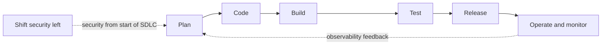

| Best practice | Benefit |
|---|---|
| Shift security left | Proactive issue handling |
| Incorporate compliance | Simplified reporting |
| Security training, culture | Standardized security efforts |
| Observability, traceability | Accountability, auditability |

<b>Definitions and exam traps</b>

- DevSecOps: development, security and operations converge.
- DevOps: development plus IT ops; SecOps: security plus IT ops.
- Security added at the end is the weakest approach.
- Automation does not remove need for review.

### Quick recall

| # | Fact |
|---|---|
| 1 ⭐📓 | Consortium with shared compliance means community cloud |
| 2 | Customer always keeps accountability for data, identity, configuration |
| 3 | IaaS: OS and apps customer; PaaS: sandbox; SaaS: thin client apps |
| 4 | Virtualization concentrates risk on host, hypervisor, console |
| 5 | Containers share a kernel; isolation weaker than VMs |
| 6 📓 | BYOD personal and business separation: containerization |
| 7 | SVC more secure than PVC: shorter exposure |
| 8 | VLANs are not subnets |
| 9 | Protect SDN controller; mandatory TLS stops MITM |
| 10 | Shift security left; monitor configurations with CSPM |
