# 5.9 Mobile, Wireless and Internet of Things Devices: Diagrams

[← Domain 5](../README.md) | [Study notes](../Study-Notes/5.9-Study-Notes.md)

> Markers: 📓 = in my notes, ⭐ = frequently tested, ➕ / ⚠ Check = unverified, shown as "(unverified)".

## Section map

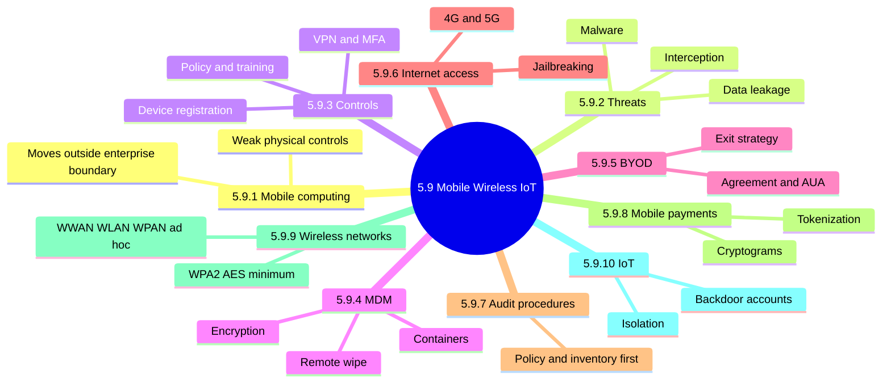

### 5.9.1 Mobile computing

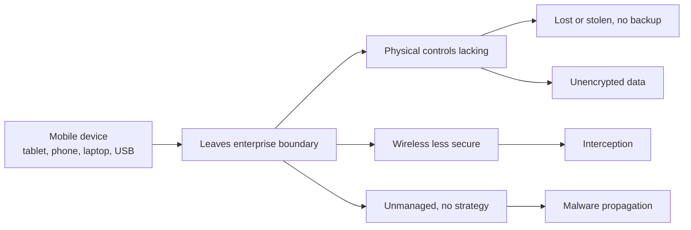

<b>Vulnerabilities (Figure 5.48)</b>

- Bluetooth left on and discoverable
- No authentication requirements
- Unsigned third-party applications
- Unmanaged device, no mobile strategy

<b>Exam traps</b>

- Mobility is the root cause; missing controls are the symptom.
- Missing mobile strategy is a governance gap, not technical.

### 5.9.2 Mobile device threats

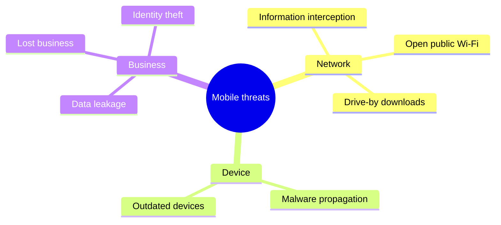

<b>Exam traps</b>

- Identify the attack method first, then choose the matching control.

### 5.9.3 Mobile device controls

| Risk | Matching control |
|---|---|
| Lost or stolen device | Encryption, strong lock screen, auto-lock, backup |
| Unauthorized device | Device registration, approval, MFA |
| Interception on public Wi-Fi | Avoid public networks, VPN |
| Malware | Official stores only, updates, virus detection |
| Bluetooth abuse | Disable Bluetooth when unused |
| User behavior | Acceptable use policy, awareness training |
| Loss of device | Report as security breach, due care |
| Network access | Authentication, authorization and accounting |

<b>Exam traps</b>

- Lost device is treated as a security breach.
- Policy and training are preventive, not technical enforcement.

### 5.9.4 Mobile Device Management (MDM)

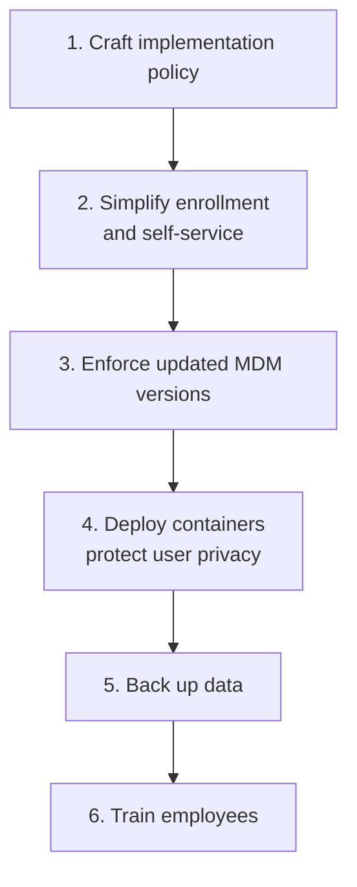

| Basic MDM feature | Purpose |
|---|---|
| Encryption | Protect stored data |
| Remote wipe | Remove data; not guaranteed permanent |
| Device lockout | Block lost device |
| Assets management | GPS tracking |
| Application control | Limit apps |
| Credential management | Control secrets |
| Secure remote support | Troubleshooting |

<b>Exam traps</b>

- Policy comes before the tool; MDM first is wrong.
- Containers let MDM rules apply only to work activity.
- Remote wipe may not permanently remove data (⚠ Check, unverified detail: recovery tools).

### 5.9.5 Bring Your Own Device (BYOD) 📓⭐

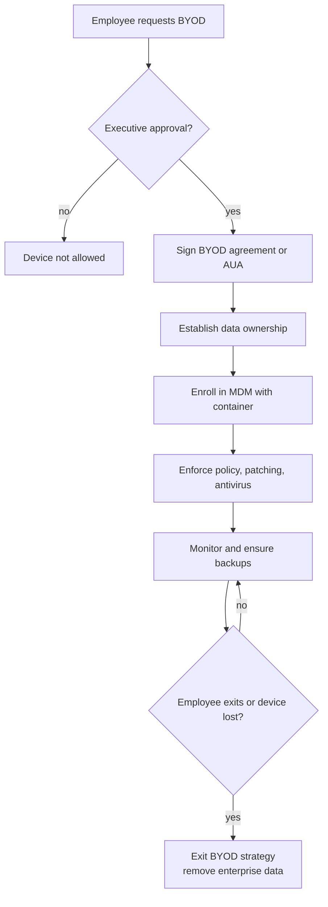

Threat defines the control 📓

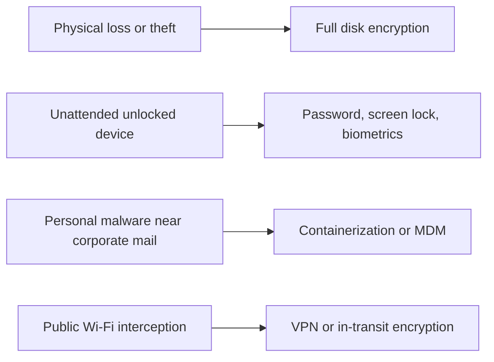

<b>Exam traps</b>

- Passwords alone fail against theft; the drive can be extracted.
- Encryption does not stop use of an unlocked device.
- VPN does not protect stored data on a stolen device.
- Containers separate data; they do not encrypt public Wi-Fi traffic.
- Weakest BYOD point: missing data ownership and exit rules.

<b>BYOD best practices</b>

- Establish data ownership; obtain user acceptance.
- Define patch management and antivirus management.
- Consider infrastructure requirements.
- Devices may be seized for legal matters.

### 5.9.6 Internet access on mobile devices

| Access | Note |
|---|---|
| WLAN | Wi-Fi access |
| 4G | IP packet-switched |
| 5G | Low latency, high speed |

<b>Exposures</b>

- Interception, loss or theft, data loss, misuse
- OS vulnerabilities and jailbreaking
- Application vulnerabilities, weak wireless authentication, weak file security

<b>Exam traps</b>

- Jailbreaking raises risk; apps may not come from secure sources.

### 5.9.7 Audit procedures for mobile devices

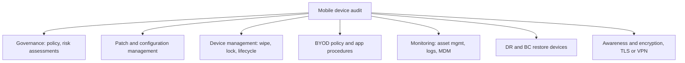

<b>Exam traps</b>

- Best first evidence: approved policy plus device inventory.
- Auditor verifies controls operate; does not configure devices.

### 5.9.8 Mobile payment systems

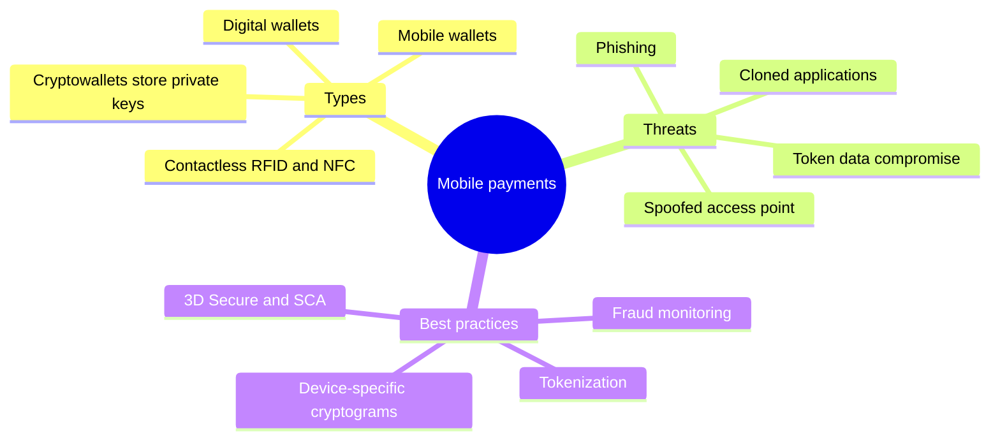

<b>Exam traps</b>

- Tokenization does not prove device identity.
- Cryptogram binds payment to device; token alone cannot.

### 5.9.9 Wireless networks

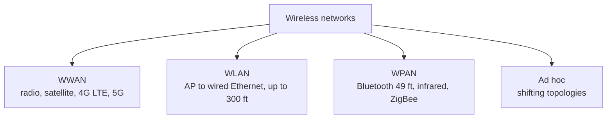

Wireless security protocols comparison ⭐

| Protocol | Encryption | Integrity / auth | Verdict |
|---|---|---|---|
| WEP | RC4, static keys, 40-bit | CRC-32 | Weak, never acceptable |
| WPA | RC4 with TKIP | MIC; 4-way handshake | Interim fix for WEP |
| WPA2 | AES with CCMP (ratified 2004) | CBC-MAC; 4-way handshake | Minimum acceptable; key vulnerability |
| WPA3 | Not detailed in notes | SAE; protected management frames | Preferred, newest |

- WPA-Personal for home; WPA-Enterprise needs a RADIUS server.
- WPA3 resists dictionary attacks and auto-encrypts public networks.
- WPA3 integrity listed as SHA, and enterprise key length listed as "198-bit": garbled, unverified. Likely 192-bit (unverified); do not memorize.

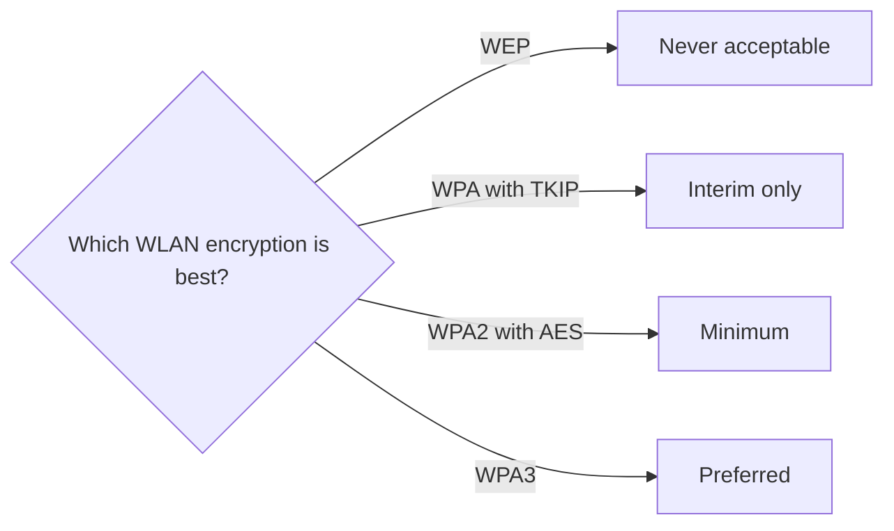

<b>Secure encryption protocols</b>

- 802.1X/EAP: port-based access control, RADIUS, TACACS.
- EAP-TLS and PEAP acceptable; LEAP and EAP-MD5 not.
- CCMP uses AES 128-bit; preferred for 802.11i.
- TKIP: RC4 key mixing, unreliable.
- MAC filter is spoofable, not authentication.

<b>Wireless threats and audit</b>

- Rogue and unauthorized APs; Bluetooth sniffing.
- Rogue AP fix is detection, not stronger encryption.
- Audit: policy, site survey, change default settings, wireless IDS.
- Encryption 128-bit minimum, no WEP.
- SSID without organization name; hiding SSID is weak security.
- Default settings unchanged is a common high-risk finding.

### 5.9.10 Internet of Things (IoT)

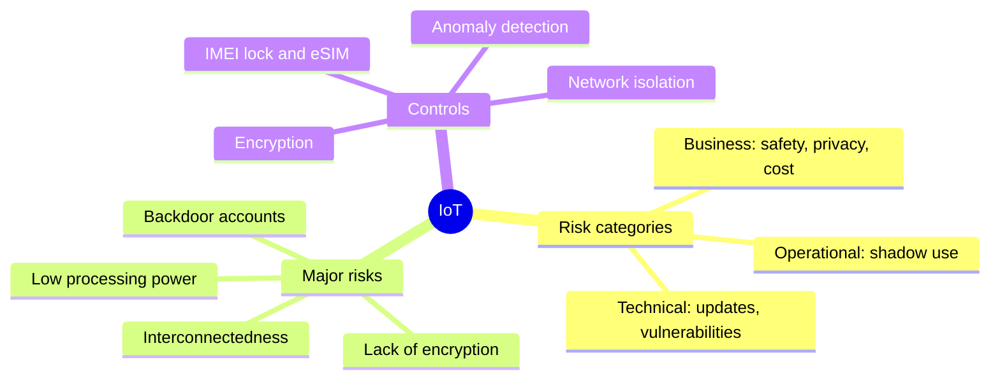

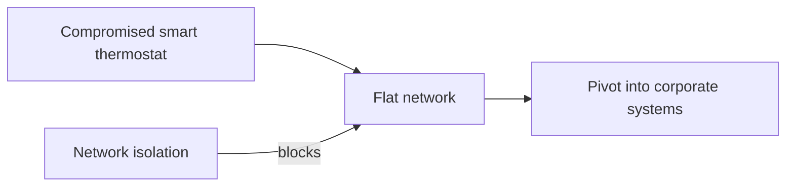

<b>Exam traps</b>

- Isolation and segmentation: strongest answer for unpatchable devices.
- Default and backdoor accounts are a typical IoT finding.
- Security event management belongs to Part B, not 5.9 (⚠ Check, unverified placement).

### Quick recall

| Fact | Answer |
|---|---|
| ⭐ BYOD key documents | Agreement or AUA, executive approval |
| ⭐ Theft | Full disk encryption |
| ⭐ Public Wi-Fi | VPN |
| Policy vs tool | Policy before MDM |
| WLAN encryption | WPA2 with AES minimum, WPA3 preferred |
| WEP | Never acceptable |
| Rogue AP | Detect it |
| Unpatchable IoT | Isolate it |
| Remote wipe | Not guaranteed permanent |
